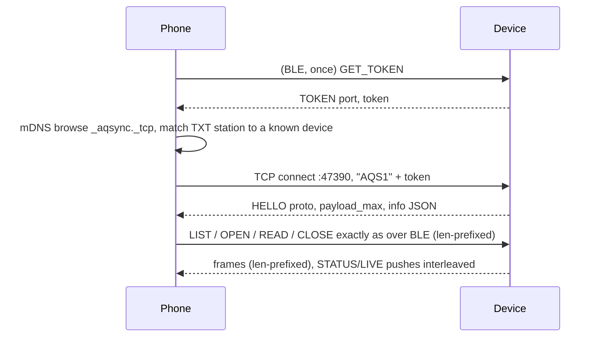

# Device and phone sync over BLE and LAN


> **Board scope:** AQCommon, AQRuntime, AQConnectivity and AQLogger implement this shared contract for the CoreS3 and Waveshare V2 logger adapters. `info` identifies the board-owned schema, dictionary and firmware; a `cores3-*` identity or CoreS3 measurement must not be relabeled as Waveshare evidence. The retained Waveshare UART/TF diagnostic does not start these services.

Load when implementing or debugging BLE, the local Wi-Fi/TCP server, or a phone
client. Current firmware reports **proto 3** on BLE info, LAN HELLO and mDNS.
Mobile rejects earlier protocols. STATUS/LIVE JSON is bounded to 480 bytes and
BLE response frames to 512 bytes. The historical v2.1 advertising layout still
applies, with the UUID list in the scan response. Hardware evidence and limits belong to
the [CoreS3 bench](../boards/m5stack-cores3/bench-verified.md) and
[Waveshare bench](../boards/waveshare-esp32-s3-sim7670g/bench-verified.md).
CoreS3-specific radio constraints remain in its
[wireless note](../boards/m5stack-cores3/cores3-wireless.md); the shared row/file
contract is in [telemetry-pipeline](telemetry-pipeline.md).
Configuration/control, pairing modes and token-authenticated LAN remain part of
the contract. Sensor identity and the opt-in batch candidate use authenticated
CONFIG, while LIVE stays raw. See [background sync triggers](background-sync-triggers.md)
for phone use of advertising hints.

The current source uses pure **ESP-IDF 6.1** native NimBLE GATT/GAP and native
Wi-Fi/netif/SNTP with managed mDNS. Native board and generic builds plus host
contracts establish implementation compatibility. A short native CoreS3 USB/SD
readback has dated evidence, while proto 3 phone transfers, bonded reconnect,
radio coexistence and durability still need image-specific qualification. Wire UUIDs,
archive semantics and board dictionaries are preserved. Arduino-era
bond-store compatibility is not guaranteed; qualify reconnect/re-pairing while
retaining station/config NVS. [Migration validation](development.md#native-migration-validation-2026-10-09).

**Protocol 3** (issue #1, 2026-10-11) is a breaking contract with no backward
compatibility. Mobile refuses a device that reports `proto` below 3. It adds
typed disconnect reasons, best-effort LAN `BYE` on usable sockets,
`GET_DIAG`/`DIAG`, `ABORT`/`ABORTED`, a 32-bit `LIST_END.count`, STATUS `dc`
and `dr` (next to `sd_state`), a 65535-byte `LOG_TAIL` and a persistent PSRAM log. See
[Protocol 3 contract](#protocol-3-contract). Since issue #2 firmware reports
`info.proto=3`, `HELLO.proto=3` and TXT `proto=3`, writes LAN frames through a
non-blocking per peer ring, closes LAN sockets with the BYE close sequence and
lets `ABORT` stop a running `LIST`, `READ` or `LOG_TAIL`.

## Purpose and non-goals

The system is **offline-first**: the card is the data origin, and a local archive on a phone, laptop or hub is its first copy. Logging and local sync work with no internet. Any link between device and phone — BLE today, Wi-Fi or LoRa device-to-device later — is a sync transport, and if the device or the phone happens to have Wi-Fi or a SIM, that is welcome but never required. Cloud upload, when it exists, is a separate opt-in step that runs *after* local sync and is off by default. This document covers the BLE transport. A phone within Bluetooth range must be able to, without internet or any server:

1. identify the device and its schema,
2. watch the latest readings,
3. give the device UTC once per boot,
4. list every finalized Parquet file on the microSD,
5. copy those files, byte-exact and verified, into the phone's own storage.

The device **never** deletes, rewrites or renames a finalized file because of the phone. Sync is a pull of immutable files; deduplication happens on the phone. There is no SQL, no query pushdown, no row-level API. The phone holds whole files, exactly as the USB-serial `parquet list` / `parquet get` path delivers them today (`tools/export_parquet.py`).

## Transport summary

| Item | Value |
| --- | --- |
| Role | Device = GATT server / peripheral. Phone = central. One connection at a time. |
| Advertising | Connectable, legacy PDUs, public address (the ESP32-S3 factory MAC, the same bytes `device_id` is built from — never a resolvable private address, see [address stability](#advertising-payload-v21)). **ADV**: flags + 10-byte [service data](#advertising-payload-v21) under the service UUID (31 bytes exactly). **Scan response**: complete local name `OS-xxxx` (`xxxx` = last four hex digits of `device_id`) + complete 128-bit service UUID list. Before 2.1 the UUID list was in the ADV and there was no service data; Android, CoreBluetooth and bleak all merge both PDUs into one record, so a UUID filter finds the device either way. |
| MTU | Device accepts up to 517. Phone MUST request ≥ 247 before using `control`; request 517 where supported. MTU ≥ 483 carries the maximum 480-byte STATUS/LIVE JSON in one notification. When an actual JSON value exceeds MTU − 3, its notification is omitted; use characteristic long reads for the complete cached snapshot. Frame sizes derive from the negotiated MTU: `payload_max = min(MTU − 3, 512)`. The 512 cap is the GATT attribute-value limit; Android silently drops notifications above it (measured 2026-09-17), macOS does not, so a device that sends 514-byte frames works from a laptop and fails from a phone. |
| Security | LE Secure Connections, bonding. Pairing mode is configurable (below); the default is chosen at first boot from whether a display is present, the way Meshtastic does it. In `random` and `fixed` modes every characteristic requires an encrypted **and authenticated** link (MITM); in `none` mode encrypted only. After the first bond, reconnects are silent. Unbonding is done on the phone, or with `ble.clear_bonds`; the device keeps up to 3 bonds and evicts the oldest. |
| Endianness | Every multi-byte integer is **little-endian**. |
| Text | UTF-8, no terminator, length implied by frame length. JSON where stated, ASCII-only keys. |

### Pairing modes

| `ble.pair` | Passkey | Default when | Notes |
| --- | --- | --- | --- |
| `random` | fresh 6 digits per attempt, shown on the pairing display; diagnostics record only `passkey=random` | a display is detected at first boot | Physical ownership is proven by reading the screen. This is the v1 behaviour and stays the CoreS3 default. |
| `fixed` | `ble.pin`, random **per-device** 6-digit value at first boot | no display is detected at first boot (bare ESP32-S3 PCB) | Same phone UX (Android asks for six digits). The owner obtains it with physical serial `parquet owner-pin` (or an attached pairing display), or configures another value before deployment. This owner reply is excluded from LOG_TAIL and is not printed at boot. Firmware does not ship a universal PIN. Existing installations that still stored legacy `123456` rotate it once at boot. |
| `none` | Just Works | never by default | Encrypted, unauthenticated, no prompt. For lab benches only; must be enabled deliberately. Characteristics drop the `AUTHEN` requirement in this mode so reads succeed. |

The mode and PIN are stored in NVS (`aqcfg` namespace) and are **applied at the next boot**, because the NimBLE security parameters are fixed at stack start; `SET_CONFIG` answers with `reboot_required` set and the phone offers `REBOOT`. The first-boot auto-detection result is stored, so removing the display later does not silently change the mode (again like Meshtastic — change the mode before removing the screen). A lost phone is handled by re-pairing or by `ble.clear_bonds=1`.

The native server handles `BLE_GAP_EVENT_PASSKEY_ACTION` and supplies display
passkeys with `ble_sm_inject_io`: random mode generates per-attempt digits,
fixed mode uses the stored per-device PIN. Pairing UI state is updated in that
callback. Diagnostics log only the mode and never the numeric PIN. The native
host also owns submissions, bond clearing and cached snapshot notifications.

The historical NimBLE-Arduino 2.5.1 wrapper used `onPassKeyDisplay`; its
nondefault static `setSecurityPasskey` bypassed that callback. This explains
older fixed-PIN bench/debug notes and is not a current API requirement.

### Advertising payload (v2.1)

Service data AD (type `0x21`) under the service UUID `c0a5e9f0-0001-…`, in the ADV PDU, refreshed in place (one HCI command) whenever a field changes — at most once per sample tick, in practice a few times per file window. A phone never has to connect to learn any of it, and a phone's offloaded scan filter (`deviceAddress` **and** `serviceData` with a mask on byte 1) can wake its app on a bit flip while it sleeps. Everything here is public to anyone in range: presence, counters, health bits — nothing more.

| Offset | Field | Meaning |
| --- | --- | --- |
| 0 | `ver` u8 | payload version, **1**; a phone ignores payloads with another version |
| 1 | `flags` u8 | bit 0 `no_utc` — no UTC anchor this boot (`status.utc == 0`): rows are landing in the `unsynced` tree, a phone in range should send `SET_TIME` now · bit 1 `new_files` — a file finalized since the last `LIST` answered on any link · bit 2 `sd` (`status.sd`) · bit 3 `lan` — Wi-Fi connected and the mDNS/TCP server up, so a woken phone knows whether the LAN browse is worth its 10 s · bit 4 `fail` (`status.fail`) · bit 5 `clk_restored` — `status.clk == 2`, dated from the RTC only, a time refresh is welcome but not urgent · bits 6–7 reserved, 0 |
| 2–5 | `fin` u32 | `status.fin`, files finalized this boot |
| 6–7 | `boot16` u16 | the last four hex digits of `info.boot`, so a phone notices a reboot (`fin` restarts at 0) |
| 8–9 | reserved | 0. **Never an IP address or port**: advertisements are unauthenticated, and a forged one would send the phone's LAN token to an attacker's socket. Discovery stays mDNS |

Rules: `new_files` is set when a window closes or a `FLUSH` finalizes a file and cleared when a `LIST` has been answered on any link and no file finalized during its walk (that phone now knows the file exists; a phone that then fails its download is covered by its own periodic run). `no_utc` and `clk_restored` are mutually exclusive; both clear after a host `SET_TIME`. Advertising runs in two stages (see [link parameters](#link-parameters-and-notify-flow)): fast (30 to 60 ms) for 30 s after enable, disconnect or a wake, and for 60 s after any flag flips, so a low-power scanner filtering on the flag byte still sees the change within a minute. It is slow (1 to 1.28 s) otherwise. `pixi run ble-sync scan` prints the decoded payload (`adv_ver= flags= fin= boot16=`).

### Link parameters and notify flow

These are `ble::Options` defaults, set per board through `aqsync::ServiceConfig::ble`.

| Item | Device behavior |
| --- | --- |
| Advertising | Fast 30 to 60 ms for `fast_window_ms` (30 s) after the stack starts, after every disconnect and after `ble::wake_advertising()`, and for `flag_window_ms` (60 s) after an advert flag byte changes. A change to `fin` alone does not speed it up. The first advert the logger publishes after boot sets the baseline and is no flip, so a boot advertises fast for 30 s, not 60 s. Then slow 1000 to 1280 ms with no end. The serial log records `BLE ADV mode=fast` or `mode=slow`. There is no separate pairing window, because passkey pairing happens on a connection. |
| Data length | Once the link is encrypted and authenticated, the device requests LE data length 251 octets (2120 µs), unless the central already set 251. The device sends no link request while it processes the connection, because a request there timed out while a bonded phone started encryption and the host reset that followed crashed the board. |
| PHY | 2 s after the data length request, the device prefers LE 2M for TX and RX. An MTU exchange, connection update or PHY update from the central starts the 2 s over, and a link already on 2M both ways gets no request. The central decides, and 1M stays valid. |
| Connection interval | After the PHY update completes (or 2 s without one, or at once when the PHY step sent no request), the device requests 15 to 30 ms, latency 0, 4 s supervision timeout, unless the central already chose an interval in that range. PHY and interval requests never overlap, because both carry an instant and the ESP32-S3 controller asserted when a central's own update crossed them. After 60 s with no `control` write and no `response` frame it requests 100 to 200 ms, latency 4, 4 s. The next `control` write requests the active values again. A request the stack refuses because another procedure is running is tried again every second. Both sets meet Apple's accessory limits. The central decides, so a phone must never assume either. |
| MTU | Unchanged. The phone requests 517 and must not cap it below 247. A small MTU wastes the 251-octet data length. |
| Response credits | The device holds at most `notify_credits` (4) `response` frames queued for the host. The worker takes a credit per frame and waits in 200 ms steps while none is free, taking samples between steps. A credit returns when the NimBLE host accepts the notification, not when the phone receives it. The host can refuse a frame for lack of buffers, and the device then offers the same frame again every 10 ms, so no frame is skipped or reordered. A frame outstanding with none sent for `progress_timeout_ms` (15 s) closes the link with [`slow-peer`](#disconnect-reasons) (5). Any other notify error closes it with `send-error` (14). If a close is already pending for another reason, such as a reboot, that reason stands and the device stops retrying the frame. |
| Response subscription | Turning `response` notifications off ends the response stream at once, and queued frames are dropped. Turning them on again on the same link starts a new connection generation. A request in flight then ends with no further frames, and a handle opened earlier answers ERROR 5 (bad handle), so the phone opens it again. The first subscription after connect changes nothing. A subscription NimBLE restores from the bond counts the same as a CCCD write, also when the central encrypts before the board has processed the connection, so a bonded client need not write the CCCD again. A frame refused because `response` is not subscribed is logged as `BLE REFUSE reason=unsubscribed`, and one refused because the link is not secure as `BLE REFUSE reason=insecure`, each once per session. |
| Snapshots | `status` and `live` notifications wait until no `response` frame is queued, so they never slow a transfer. Long reads always return the latest value. |

The serial log records the requests (`BLE LINK request`, `BLE CONN request`) and what the central chose (`BLE CONN itvl= lat= to=`, `BLE PHY tx= rx=`, `BLE DLE tx= rx=`). A link request the stack refuses or the controller fails is logged as `BLE HCI fail cmd= op= rc= timeout=`, where `timeout=1` (rc 19) means the controller did not answer within 2 s and the BLE host resets. A connection update retried while it keeps failing with the same `rc` logs only the first failure. Values are in Bluetooth units: interval 1.25 ms, timeout 10 ms, PHY 1 = 1M and 2 = 2M.

**Address stability.** Both the Android Companion Device Manager and per-device scan filters key on the advertised address. NimBLE uses the public address derived from the factory MAC; do not enable NimBLE privacy / resolvable private addresses on this device — every presence mechanism would silently stop matching.

## Service and characteristics

Base UUID `c0a5e9f0-XXXX-4b1a-9c3e-2d7f8a6b4e01`; the 16-bit field selects the attribute.

| Attribute | UUID | Props | Payload |
| --- | --- | --- | --- |
| **Service** AQ Sync | `c0a5e9f0-0001-4b1a-9c3e-2d7f8a6b4e01` | — | — |
| `info` | `…-0002-…` | read | JSON, ≤ 400 bytes, static for a boot |
| `status` | `…-0003-…` | read, notify | JSON, ≤ 480 bytes |
| `live` | `…-0004-…` | read, notify | JSON, ≤ 480 bytes |
| `control` | `…-0005-…` | write (with response) | binary request, ≤ 512 bytes |
| `response` | `…-0006-…` | notify | binary frames, ≤ `payload_max` (≤ 512) |

`status` and `live` are ≤ 480 bytes; their characteristic capacities are 496 bytes and the BLE frame cap remains 512 bytes. MTU ≥ 483 is required to carry the largest JSON snapshot in one notification. Each publisher caches the complete JSON value first, then omits its notification when the actual value exceeds negotiated MTU − 3. No partial JSON notification is sent. Clients with smaller MTUs must perform characteristic long reads for complete snapshots; STATUS may update its cache without emitting a notification. `info` may also exceed one PDU and uses a normal long read. All `response` traffic for one request is emitted in order on the single `response` characteristic. CONFIG replies that exceed the ATT payload use ordered `CONFIG_CHUNK` frames over BLE.

### `info` (read)

```json
{"proto":3,"fw":"idf-cores3-parquet-v6.14","schema":"cores3-telemetry-v5","cols":81,
 "dict":"<64 hex, SHA-256 of telemetry_fields.inc>","station":"<uuid>",
 "dev":"<12 hex device_id>","boot":"<32 hex boot id>","max_read":16384}
```

`schema`, `cols`, `dict` and `fw` describe the consuming board image. The example
is CoreS3, while Waveshare advertises its own 62-column schema and dictionary
`waveshare-sim7670g-telemetry-v5` with firmware `idf-waveshare-parquet-v2.8`. Clients use that identity to interpret shortened LIVE keys. `station`, `dev`
and `boot` match the archive identities. `max_read` is the largest `length` the
device honours per `READ`. Firmware reports `proto=3` and older framing is incompatible.

### `status` (read, notify)

Notified after every stored sample (every 10 s) and after any `control` request that changes state.

```json
{"up_s":12345,"int_s":900,"buf":12,"fin":764,"drop":0,"err":0,"miss":0,
 "fail":0,"codec":"LZ4_RAW","utc":1,"gen":1,"clk":2,"rtc":1,"sd":1,
 "sd_state":0,"sd_kib":31166976,"sd_used_kib":34176,"heap":180000,"part":0,"open":180,
 "open_rg":2,"dc":3,"dr":12}
```

| Key | Meaning |
| --- | --- |
| `up_s` | seconds since boot |
| `int_s` | rotation interval in seconds (600 or 900; firmware v6 adds 1800 and 3600, set over serial only) |
| `buf` | rows buffered in RAM, not yet in any file |
| `open` / `open_rg` | firmware v6: rows and row groups already written and synced into the open `.partial` file whose footer is still pending; they become listable after the window closes or a `FLUSH`. Absent on v5 |
| `fin` / `drop` / `err` / `miss` | same counters as `PARQUET STATUS` and the row fields `files_finalized`, `rows_dropped`, `storage_errors`, `sample_deadlines_missed` |
| `fail` | 1 when the storage worker is not writing. Since #5 this follows `sd_state`, so it is 1 for `full` and `retry` |
| `sd_state` | SD space governor, additive since #5. 0 ready, 1 degraded (below the high mark, still writing), 2 full (below the hard reserve, rows wait in RAM until the batch or window is full, later rows are dropped and counted in `drop`, nothing is deleted), 3 retry (a write, close, rename or mount failed, or no card yet, probes back off from 10 s to 10 min). Logging resumes by itself once space returns or the card answers. Absent on older firmware |
| `utc` / `gen` | 1 when a UTC anchor is set; discontinuity generation (`clock_epoch`) |
| `utc_ms` / `clk_age_s` | CoreS3 v6.10 / Waveshare v2.4: current UTC estimate in milliseconds and whole seconds since the latest accepted anchor, measured at STATUS construction. Both null without an anchor; absent on older firmware. These are current snapshots, not the last ten-second sensor row. Phone comparisons account for request round-trip delay; they are policy evidence, not measured accuracy. |
| `clk` / `rtc` | firmware v6.2. `clk` is the anchor source, same codes as `clock_status`: 0 none, 1 host time set on this boot, 2 restored at boot from the RTC (an earlier external sync, whole seconds plus drift), 3 network SNTP. `rtc` is the RTC chip state: 0 not read, 1 in use or written, 2 unusable (absent, voltage-low, invalid calendar). Absent on ≤ v6.1. Both are small unsigned codes (the formatter prints them as u8). The common Android/iOS session refreshes unset/RTC clocks, external anchors older than six hours, or current estimates more than two seconds away from the phone before archive listing. Fresh host/network clocks keep their existing anchor; older firmware without clock evidence is refreshed once per connection |
| `sd` | 1 when the card is mounted and the output directory exists |
| `part` | retained `.partial` files seen at the last listing |
| `qf` / `qb` | retained quarantine file count / bytes after startup quarantine; includes earlier boots |
| `ls` | `LIST_SINCE` mount epoch, the FAT volume serial of the mounted card as a u32, 0 while no card is mounted or the serial is unknown. A phone compares it with the `mount_epoch` of its saved cursor to know before listing whether the cursor still applies. Absent on older firmware |
| `dc` / `dr` | proto 3. `dc` counts BLE and LAN sessions closed since boot, including refused LAN clients, saturating at 65535. `dr` is the newest [disconnect reason](#disconnect-reasons) code, or null while `dc` is 0 |

A board without an enabled RTC adapter reports `rtc=2`. Each boot starts with
`utc=0`, `clk=0` and null UTC row fields until automatic host SET_TIME or successful Wi-Fi SNTP; it cannot restore a
previous host anchor from hardware. CoreS3 can restore the earlier host-written
BM8563 value as `clk=2`; a fresh host sync is still welcome.

### `live` (read, notify)

Notified once per sample. Each board declares a short `live_key` next to the fields it publishes, and the shared logger emits those keys in the board's field-table order.

**LIVE rule.** Every LIVE key the board declares is present in every LIVE object. Its value is a number, or JSON `null` when the sample has no usable reading for it. That covers a value that is invalid or unavailable, a non-finite float (NaN or Inf), a value whose printed text is 32 characters or longer (at the decimals the boards use today, only a float of magnitude 1e27 or more gets there), and a UTC instant whose nanosecond form overflows INT64. Null is never sent as zero. An absent key means only that the board has no such field. The set of keys a board can send comes from its dictionary, the `live_key` in its `telemetry_fields.inc` (later the template `firmware.live_keys`). Clients parse the object by key name and ignore keys they do not know. Breaking changes are listed in [mobile-migration.md](mobile-migration.md).

Each field's `live_key` and `decimals` are part of the board's `telemetry_fields.inc`, so the `info.dict` digest covers the LIVE key map and how each float prints. A client picks its reviewed LIVE profile by that digest. The current digests are CoreS3 `4f80c26c…` and Waveshare `6f567b38…`. The digest hashes raw bytes, so a comment, whitespace or line ending edit to `telemetry_fields.inc` moves it. A client that does not know the digest may still read the keys in the table below under the [LIVE key stability](#live-key-stability) rule.

**Float precision.** Integers print with no point. A float prints rounded to the `decimals` its field declares, chosen from the sensor resolution, so `1.00` and `1.0` are both possible and both mean the number one. Today CoreS3 prints `t` with two decimals (SHT20 steps 0.01 degC) and `imu_t` and `rh` with one. Waveshare prints `t` and `rh` with one (PMS5003T steps 0.1). Clients parse the value as a number and keep their own display rounding.

```json
{"seq":15021,"mono":150210000000,"utc":1757990410000000000,"pms":4,
 "c1":5,"c25":7,"c10":9,"pm1":5,"pm25":7,"pm10":9,
 "n03":900,"n05":250,"n1":30,"n25":2,"n5":0,"n10":0,
 "imu_t":31.4,"als":120,"vbus":5000,"bat":4100,"pct":80,"chg":0}
```

| Key | Dictionary field |
| --- | --- |
| `seq`, `mono`, `utc` | `sequence`, `monotonic_us`, `event_time_utc_us` (null when unsynchronized). `utc` stays in nanoseconds, the file column `event_time_utc_us` × 1000 |
| `pms` | `pms_status` code: 0 absent, 1 warming, 2 stale, 3 sensor error, 4 valid |
| `pm1`,`pm25`,`pm10` | `pm*_atmospheric_ug_m3` — the values to display |
| `c1`,`c25`,`c10` | `pm*_cf1_ug_m3` |
| `n03`,`n05`,`n1`,`n25`,`n5`,`n10` | `particles_gt*_per_01l`; PMS5003T exposes only `n03`, `n05`, `n1`, `n25`. It has no `n5`/`n10` measurements |
| `t` | `ambient_temperature_c`, ambient air temperature only. Waveshare PMS5003T reports it. CoreS3 has no resolved ambient sensor, so `t` is always null there |
| `rh` | `relative_humidity_percent`, null when unavailable |
| `imu_t` | CoreS3 `imu_temperature_c`, IMU die temperature. Never show it as air temperature |
| `bat`,`pct`,`chg`,`vbus` | `battery_mv`, `battery_percent`, `charging_status`, `vbus_mv` when valid. CoreS3 uses raw `M5.Power` reports; with no battery attached it has shown misleading battery values. Waveshare leaves battery fields null without an initialized, valid gauge/battery source; USB-only operation does not imply a battery measurement. Waveshare checks VCELL and SOC on their own, so `bat` can hold a value while `pct` is null and the reverse |
| `bstate` | Waveshare `battery_health_state` code: 0 unknown, 1 external power likely, 2 ok, 3 low, 4 critical, 5 settling after a gauge reset. Inferred from cell voltage only, thresholds are uncalibrated |
| `als` | CoreS3 `light_ch0_raw` |

PM keys hold values only when `pms == 4` and are null otherwise. The snapshot is the same row that was queued for storage; it is a display convenience, not a substitute for the stored file.

The whole object must fit 480 bytes. The firmware never sends a truncated object. When a row would need more, the device publishes the object with every declared key set to `null` for that sample over BLE and LAN, instead of keeping the previous snapshot. A phone gets that all-null object as its LIVE notification and as the cached value, so it never shows an old sample as current. The next row that fits restores the full object. The device logs `PARQUET LIVE overflow bytes=<n> max=480` to serial and `LOG_TAIL`, where `n` is the exact size the full object needed without the terminating NUL. The line repeats at most once an hour while overflows continue. The host contract tests build each board's widest real row, every declared key at the widest value its producer can write or at `null` where null is wider, with a 19 digit `utc`. Measured 2026-10-26 with per field decimals it is 333 bytes on CoreS3 and 270 bytes on Waveshare, and the all-null object is 265 and 211 bytes. The tests fail if any of them passes 480.

#### LIVE key stability

- A LIVE key never changes meaning once released. Meaning is the quantity, the unit, the source (board or ambient air) and what each existing code value means. Adding a new code value is allowed and counts as a layout change below. Changing what an existing code value means is not allowed. A new meaning gets a new key. A retired key is never reused.
- Each key in the table above means the same thing on every board. `imu_t` is always the IMU die temperature, never air. `t` is always ambient air temperature. A board that declares a key and has no valid value for it sends the key as null.
- Firmware may add or drop keys. Clients read keys by name and ignore keys they do not know, so an app that meets an unknown digest can still show the keys in this table and hide the rest. It never guesses a meaning from a device name, a firmware string or a value.
- Older CoreS3 builds that sent the IMU die temperature as `t` predate this rule and are not supported. No release may do the same.
- Every firmware release whose LIVE layout changes says **needs app update** in its release notes and in its [mobile-migration.md](mobile-migration.md) entry. A layout change is a key added, removed or renamed, a new code value, or a change in the decimals a float prints with. A digest that moves without a layout change still gets a fixture in `tools/fixtures/live_keys/` and a migration entry. Apps with the unknown digest fallback (opensensor-space-mobile #153) keep their live readings. Apps without it still show no live readings until they map the new digest.

### `control` (write) and `response` (notify)

First byte is the opcode. Unknown opcode → `ERROR` code 11.

Opcodes and response frame types are separate number spaces. Opcode `0x10`
is `LIST_SINCE` and frame type `0x10` is `FILE`, and a phone tells them apart
by direction.

| Op | Name | Request body | Response frames |
| --- | --- | --- | --- |
| `0x01` | `LIST` | — | `FILE` × n, then `LIST_END` on a complete scan, or `ERROR` |
| `0x02` | `OPEN` | `name` utf8 (rest of packet) | `OPENED` or `ERROR` |
| `0x03` | `READ` | `handle` u16, `offset` u32, `length` u32 | `CHUNK` × n, then `READ_END` |
| `0x04` | `CLOSE` | `handle` u16 | `CLOSED` |
| `0x05` | `SET_TIME` | `epoch_s` i64, optionally `subsecond_us` u32 | `TIME_SET` or `ERROR` 9; `status` notify |
| `0x06` | `FLUSH` | — | `FLUSHED` or `ERROR` 10; `status` notify |
| `0x07` | `STATUS` | — | `status` cache/notify only; **no `response` frame**, so the phone must not wait on `response` for it. If the value exceeds MTU − 3 the notification is omitted and the phone reads the cached characteristic. Over LAN this produces a `STATUS` push frame, so it doubles as a keep-alive ping. |
| `0x08` | `GET_CONFIG` | empty or one page byte `0..4` | `CONFIG` or BLE `CONFIG_CHUNK` sequence |
| `0x09` | `SET_CONFIG` | `key=value` lines, utf8, `\n`-separated (see [configuration](#device-configuration-v2)) | `CONFIG` or BLE `CONFIG_CHUNK` sequence; `ERROR` 12 with the offending key as `detail` |
| `0x0A` | `WIFI_SCAN` | — | `WIFI_AP` × n, then `WIFI_SCAN_END`; `ERROR` 15 if the radio cannot scan |
| `0x0B` | `REBOOT` | — | `REBOOTING`, then the device finalizes any RAM batch and restarts |
| `0x0C` | `LOG_TAIL` | `max_bytes` u16 (device clips to the bytes it retains, at most 65535) | `LOG` × n, then `LOG_END` |
| `0x0D` | `GET_TOKEN` | — | `TOKEN`; **BLE only**, `ERROR` 13 over LAN |
| `0x0E` | `GET_DIAG` | empty (any body is `ERROR` 1) | `DIAG`, or `ERROR` 7 `detail="mtu"` when `payload_max` is below 38 |
| `0x0F` | `ABORT` | empty (any body is `ERROR` 1) | `ABORTED` with the op it stopped, `op=0` when idle |
| `0x10` | `LIST_SINCE` | cursor, 32 bytes. See [LIST_SINCE](#list_since) | `FILE` × n, then `LIST_SINCE_END`, or `ERROR`. Older firmware answers `ERROR` 11 |

| Frame | Type | Body |
| --- | --- | --- |
| `FILE` | `0x10` | `bytes` u32, `name` utf8 |
| `LIST_END` | `0x11` | `count` u32, `partials` u16, `sd_kib` u32, `sd_used_kib` u32. 15 bytes with the type (proto 3, was 13 with a u16 count) |
| `OPENED` | `0x20` | `handle` u16, `size` u32, `crc32` u32, `name` utf8 |
| `CHUNK` | `0x21` | `handle` u16, `offset` u32, `payload` (≤ `payload_max − 7`) |
| `READ_END` | `0x22` | `handle` u16, `next_offset` u32, `status` u8 (0 = ok, else error code) |
| `CLOSED` | `0x23` | `handle` u16 |
| `TIME_SET` | `0x30` | `epoch_s` i64, `monotonic_us` i64, optional `subsecond_us` u32 matching the request |
| `FLUSHED` | `0x31` | `rows` u16 written, `fin` u32 files finalized so far |
| `CONFIG` | `0x40` | `flags` u8 (bit 0 = reboot required for a pending `ble.*` change), JSON ≤ 480 bytes |
| `WIFI_AP` | `0x41` | `rssi` i8, `auth` u8 (0 open, 1 WEP, 2 WPA, 3 WPA2, 4 WPA/WPA2, 5 WPA2-Enterprise, 6 WPA3, 7 WPA2/WPA3, 255 other), `channel` u8, `ssid` utf8 |
| `WIFI_SCAN_END` | `0x42` | `count` u16, `status` u8 (0 ok, else error code) |
| `REBOOTING` | `0x43` | `delay_ms` u16 |
| `LOG` | `0x44` | utf8 text, a slice of the serial log ring in order |
| `LOG_END` | `0x45` | `total` u32 bytes logged since boot, `returned` u16 |
| `TOKEN` | `0x46` | `port` u16, `token` 32 bytes |
| `HELLO` | `0x47` | LAN only: `proto` u8, `payload_max` u16, info JSON (same document as the `info` characteristic) |
| `STATUS` | `0x48` | LAN only, push: status JSON |
| `LIVE` | `0x49` | LAN only, push: live JSON |
| `BYE` | `0x4B` | `reason` u8, `generation` u32, `err` i16, `queued` u16, `uptime_s` u32. 14 bytes with the type, 16 on the LAN wire. See [BYE](#bye) |
| `DIAG` | `0x4C` | `boot_seq` u16, `counts` 17 × u16, `n` u8, then `n` × 16-byte events. 38 + 16n bytes. See [DIAG](#get_diag-and-diag) |
| `ABORTED` | `0x4D` | `op` u8, the opcode that was stopped, 0 when nothing was running |
| `LIST_SINCE_END` | `0x4E` | the 14 `LIST_END` body bytes, `flags` u8, then the next cursor (32 bytes). 48 bytes with the type. See [LIST_SINCE](#list_since) |
| `CONFIG_CHUNK` | `0x4A` | BLE only: `flags` u8 (same as CONFIG), `total_json_bytes` u16 LE, `offset` u16 LE, then a raw UTF-8 JSON slice. The header is 6 bytes; slices are at most 128 bytes and frames never exceed negotiated `payload_max`. A UTF-8 character may cross frames, so assemble bytes before decoding JSON. Require contiguous offsets from zero until `offset + slice_bytes = total_json_bytes`, with identical flags and total length on each chunk. There is no terminal frame; abandon an incomplete answer and make a fresh GET_CONFIG request |
| `ERROR` | `0x7F` | `op` u8, `code` u8, `detail` utf8 |

The status JSON remains bounded to 480 bytes. The actual formatter retains every key at 467 bytes with the widest representable values, including `sd_state`, `dc=65535`, `dr=255`, `clk`/`rtc` at their u8 limit, `ls` at its u32 limit, and the clamped `utc_ms`, `clk_age_s` and `miss` (462 for LZ4), checked by `pixi run logger-status-test`, which also requires 10 bytes of headroom. In addition to the existing counters, `part` is the number of retained `.partial` files found by the startup/list scan, while `qf` and `qb` are the total file count and total bytes currently under `/output/quarantine/` after startup quarantine completes. `qf` and `qb` include files preserved by earlier boots, not only files moved during the current boot; both saturate at their unsigned integer limits rather than wrapping.

`ERROR.op` echoes the **first byte of the request** as received, even when that byte is not a known opcode (code 11); an empty write is reported as `op=0x01 code=1 detail="empty"`. `OPENED.name` is the requested name in full; the device does not shorten it (names are ≤ 399 bytes, so on an MTU-517 link every `OPENED` fits one PDU, another reason the phone must negotiate 517). A `FILE` entry whose name would not fit `payload_max − 5` aborts LIST with error 7 (`detail="mtu"`) and is logged on serial as `BLE LIST SKIP`. An archive exceeding the u32 count capacity aborts LIST with error 7 (`detail="count"`). Filesystem enumeration failures (including an SD read failure after earlier entries) abort LIST with error 8. Neither case produces `LIST_END`. Clients commit a replacement listing only after a valid `LIST_END`; preceding `FILE` entries alone are an incomplete snapshot. The device clears its `new_files` hint only after a complete scan and accepted `LIST_END` delivery. `READ_END.next_offset` always equals `offset + bytes actually delivered in CHUNK frames`; a phone that received fewer bytes has lost a notification and must treat the **window** as failed, never trust `next_offset` over its own count, and a failed window is retried with a new `READ` from the phone's own offset, not an aborted sync. Measured 2026-09-17: an Android phone's Bluetooth stack dropped runs of 16 to 18 consecutive notifications at the start of a window while the board's Wi-Fi was active (the same windows reached a Mac intact), so clients should keep reading until that request's `READ_END` before re-issuing, and are advised to use ≤ 4 KiB windows over BLE (16 KiB over LAN).

Error codes: 1 malformed request · 2 invalid name · 3 not a finalized Parquet file · 4 open failed · 5 bad handle · 6 range outside file · 7 busy (command queue full on a secure link, transfer in progress, another LIST running, a LIST ended by a storage remount, or a LIST or READ stopped early so the device can close its open file on a critical battery, retry later) · 8 storage unavailable · 9 invalid epoch (outside 2020 to 2100, or invalid microsecond fraction) · 10 nothing to flush · 11 unknown opcode · 12 invalid config (`detail` = key) · 13 not allowed on this link · 14 authentication failed (over LAN, a bad handshake token. Over BLE it is defense in depth and an unpaired client normally never sees it. NimBLE refuses an unencrypted Control write with ATT error 0x05, 0x0C or 0x0F before the firmware runs, and that error is what makes the phone pair. Its CCCD writes have no security flag, so it can subscribe to `response`, but nothing is sent there on an unpaired link except a possible ERROR 14. In this firmware the ATT check applies the same rule as the firmware check (encryption in every mode, plus authentication and a 16 byte Secure Connections key in the passkey modes), so ERROR 14 with `detail="auth"` is only a guarded fallback if the two ever disagree. Then the Control write is acknowledged, not run, and answered with that ERROR. Neither answer is busy, never retry it, pair again) · 15 Wi-Fi unavailable · 16 aborted (proto 3).

Rules:

- **Names** are the same relative paths the serial `PARQUET FILE name=` line prints: `station=…/year=…/month=…/day=…/data_HHMM_<boot>_<first>-<last>-<n>.parquet`, `station=…/unsynced/boot=…/…`, or `legacy-parquet/…`. Since #5, `codec-test` copies live under `/sd/bench/boot=…/` outside the archive root and are never listed. Older cards may still list `benchmarks/boot=…/…`. Same character whitelist as `safe_name()` in the firmware: `[0-9a-z._=/-]`, no `..`, no `//`, ends in `.parquet`.
- **`OPEN`** runs the finalized-file check (magic `PAR1` head and tail, footer length sane) and returns the CRC-32 (IEEE, same as the serial `crc32=` field) of the whole file. The device remembers the CRC it computed when it finalized the file, keyed by path, size and modification time, so `OPEN` of a recent file skips the full read. A cache miss (an older file, a reboot, a remount) reads the whole file once. Either way the value is the same. At most one logical file is open per connection; a new `OPEN` implicitly closes that connection's previous one without affecting other connections. Handles start at 1 and are invalid after disconnect. A path that does not exist is `ERROR` 3. A file the device cannot open for another reason, such as a full descriptor table, is `ERROR` 4.
- **CRC-32 check values.** Device (ROM table routine) and host tools agree on these, and a phone CRC implementation must too. Empty input is `00000000`. ASCII `123456789` is `cbf43926`. ASCII `The quick brown fox jumps over the lazy dog` is `414fa339`. The 1 MiB fixture whose byte `i` is `((i*31+7) & 0xff) ^ ((i>>12) & 0xff)` is `391e95d7`. Chunk boundaries never change the result.
- **`READ`** is clipped to `max_read` and to end-of-file. Chunks are delivered in offset order; `next_offset` tells the phone where to continue. Offsets are absolute, so a phone can resume after a disconnect by `OPEN` + `READ` from where it stopped, provided `size` and `crc32` in the new `OPENED` frame match the earlier one (the file is immutable, so they must). After a storage remount the card may have been edited or swapped, so the first `READ` on each open handle runs the finalized check again. The same `size` and `crc32` keep the handle and the read proceeds. Only a proven change drops the handle. That is a different size or CRC from a completed check, or a file that is missing or no longer finalized on a card that mounted again. That `READ` answers `ERROR` 5 (bad handle), as does every later `READ` or `CLOSE` on it. The phone fails that file for the current run and a fresh `LIST` and `OPEN` decide what to fetch next. While the card has not mounted again, or when the check hits an I/O error or a short read, or the descriptor table is full, `READ` answers `READ_END` status 4 with no `CHUNK`. The handle stays valid and the check runs on the next `READ`. `CLOSE` on a handle still waiting for its check answers `CLOSED`.
- A file is **complete** only when the phone has `size` bytes, its own CRC-32 equals `OPENED.crc32`, and the head/tail magic is `PAR1`. Anything else is discarded, never presented as data.
- `SET_TIME` anchors to the device monotonic timestamp captured when the request arrived. The legacy eight-byte body supplies whole UTC seconds and receives the unchanged 17-byte `TIME_SET` frame. A twelve-byte body appends little-endian `subsecond_us` (0–999999), and receives a 21-byte frame with that fraction appended after the unchanged prefix. The upper endpoint 2100-01-01 permits only fraction zero. New phones first try the precise form and may retry the legacy form only on the explicit malformed-request error from old firmware. A timeout does not prove that the command failed. Transport delay and phone clock error remain unmeasured; precision is not an accuracy guarantee.
- CoreS3 v6.10 / Waveshare v2.4 accept the exact incoming anchor for future samples without flushing the current interval or creating a singleton file. Initial UTC, an RTC-to-external upgrade, and a correction strictly larger than two seconds in either direction start a new clock epoch; the next genuine sample closes the previous epoch/window. Small host/network refreshes keep the epoch, and each future row records its exact new anchor and source. Earlier rows retain their original UTC, epoch and anchor. Finalization records the latest same-boot reconciliation anchor in the footer; TIME_SET also supplies boot-scoped evidence to the phone. Accepted time is not an SD durability acknowledgement. Older firmware finalized every anchor and its first timed sample.
- CoreS3 writes external UTC through its optional BM8563 callback on the main-loop task and can restore it at boot as `clk=2`. Successful Wi-Fi SNTP produces `clk=3`; Wi-Fi association alone is not an anchor. A board without usable RTC starts unanchored on each reboot. Disconnection during an uninterrupted boot retains its current monotonic UTC estimate. A later reboot's anchor must never date a prior unanchored boot.
- Routine/background sync lists completed files and leaves the current interval open. Explicit “sync now” deliberately requests current unfinished readings using `FLUSH`.
- `FLUSH` finalizes the RAM batch — and, on firmware v6, any row groups already in the open file — so the phone can pull everything up to now. Use it deliberately (a "sync now" action); it produces a short file and does not change the rotation interval. The `FLUSHED` row count is RAM rows plus rows that were already on the card in the open file.

## Device configuration (v2)

`GET_CONFIG` page 0 (empty body or byte 0) returns the legacy snapshot below. Pages 1–4 return additive location/time configuration using the same CONFIG or CONFIG_CHUNK envelope. `SET_CONFIG` accepts the keys below and always acknowledges with the legacy page-0 snapshot. `SET_CONFIG` is **partial**: only the keys present change. Values are validated as a whole before anything is stored; one bad key rejects the request with `ERROR` 12 and nothing changes. Keys marked *action* are not stored, they do something once. The firmware persists the complete configuration as one CRC-checked NVS record with a single write and commit, then reads it back. A persistence failure keeps the previous saved record and the live snapshot is not published. A damaged or missing record falls back to the older per-key settings. Power-cut behavior is not yet measured on hardware. Secrets are write-only: `wifi.psk` is never echoed, `GET_CONFIG` reports `psk_set` instead; the fixed BLE PIN is also not echoed and is represented by `pin_set`.

| Key | Value | Applied | Meaning |
| --- | --- | --- | --- |
| `ble.pair` | `random` \| `fixed` \| `none` | next boot | pairing mode, see [pairing modes](#pairing-modes) |
| `ble.pin` | 6 digits `000000`–`999999` | next boot | passkey for `fixed` mode |
| `ble.clear_bonds` | `1` | *action* | forget every bonded phone |
| `wifi.on` | `0` \| `1` | immediately | station radio on/off (off by default) |
| `wifi.ssid` | ≤ 32 bytes | immediately | network name |
| `wifi.psk` | ≤ 63 bytes, empty for an open network | immediately | passphrase, stored in NVS in clear (flash encryption is not used on this board by rule) |
| `lan.on` | `0` \| `1` | immediately | TCP sync server + mDNS while Wi-Fi is connected (on by default) |
| `lan.rotate_token` | `1` | *action* | new LAN token. A LAN caller reads its `CONFIG` reply first. Every LAN session then receives a [BYE](#bye) with reason `token-rotated` (10) and closes, and phones must fetch the token again over BLE |
| `ntp.on` | `0` \| `1` (default 1) | immediately | enable automatic native SNTP when Wi-Fi has an IP lease |
| `ntp.dhcp` | `0` \| `1` (default 1) | immediately; new DHCP options at next lease | prefer router-provided DHCP option 42 servers |
| `ntp.public_fallback` | `0` \| `1` (default 1) | immediately | allow `time.cloudflare.com` only after router/configured servers fail |
| `ntp.interval_s` | `60..86400`, default 3600 | immediately | wait between successful synchronization cycles |
| `ntp.server1`, `ntp.server2` | DNS name or literal IP, ≤253 bytes; empty clears | immediately | configured local/approved endpoints, tried in order after DHCP servers; no URLs or ports |
| `location.cell` | canonical 15-digit H3 cell hex; empty clears | next sample | persist only the cell coarsened to the configured privacy cap |
| `location.resolution` | `0..15`, default 5 | next sample | maximum disclosure precision; increasing alone never restores finer coordinates |
| `location.country` | assigned uppercase ISO 3166-1 alpha-2; empty clears | next sample | optional owner-declared country, not inferred from the cell |
| `sensor.vendor` | `Plantower` on Waveshare V2; empty only when clearing the profile | immediately | owner-identified vendor; must match the board's declared physical sensor |
| `sensor.model` | `PMS5003T` on Waveshare V2; empty only when clearing the profile | immediately | owner-identified model; does not change the hardcoded UART parser |
| `sensor.serial` | `PMS5003T-` + valid `YYYYMMDD` + 1–9 unit digits, or empty | immediately | scanned or manually entered module sticker, echoed in CONFIG; an empty value clears it. Impossible calendar dates and mismatched model prefixes are rejected |
| `sensor.batch_candidate` | `0` \| `1` | immediately | opt in to the separate, unvalidated Waveshare batch candidate; `1` requires `Plantower`, `PMS5003T`, and an exact `PMS5003T-20260408` batch prefix followed by 1–9 unit digits. Changing identity without explicitly setting this key turns it off |

```json
{"ble":{"pair":"random","pin_set":1,"pin_default":0,"bonds":1,"display":1},
 "wifi":{"on":1,"ssid":"home","psk_set":1,"state":"connected","ip":"192.168.1.42","rssi":-58,"mac":"e0..6b40"},
 "lan":{"on":1,"port":47390,"host":"os-6b40","clients":0},
 "sensor":{"vendor":"Plantower","model":"PMS5003T", "serial":"PMS5003T-202604081332","batch_candidate":0}}
```

### Additional configuration pages

Request bytes are the `GET_CONFIG` opcode followed by the optional page byte.
An invalid page or more than one body byte returns malformed ERROR. Clients
serialize requests because CONFIG has no request/page identifier. Legacy
firmware may ignore a page byte and answer its ordinary snapshot; absence of
the requested object means unsupported, not an unset location.

| Page | Response JSON |
| --- | --- |
| 0 or empty | Legacy `ble`, `wifi`, `lan`, `sensor` snapshot |
| 1 | `{"location":{"cell":"","resolution":5,"cell_resolution":null,"lat":null,"lon":null,"country":""}}`; populated cells return their actual resolution and derived center in degrees |
| 2 | `ntp` policy (`on`, `dhcp`, `public_fallback`, `interval_s`) plus `state`, `running`, `anchored`, `age_s` (null before sync), `stale`, `source`, `last_public`, `sync_count`, `error` |
| 3 | `{"ntp":{"server1":""}}` |
| 4 | `{"ntp":{"server2":""}}` |

`last_public` describes the last successful network anchor endpoint, not current
internet connectivity. The runtime status preserves previous anchor evidence
while offline/disabled. Configuration page 2 never claims NTS authentication.

Each page remains within the 480-byte JSON limit. NTP policy changes alone do
not reconnect Wi-Fi or close LAN. Router DHCP option 42 is tried first, then
configured hosts, then allowed public fallback; association alone never
establishes UTC. Location normalization happens after the complete patch, so
cell/resolution key order has no effect. Separate single NVS records hold the
coherent NTP and location policies; legacy keys keep their existing types.
Missing records receive defaults; corrupt location becomes unset and corrupt
NTP becomes disabled. A failed save does not publish the live snapshot; the
whole legacy multi-key save is still not transactional.

Location is the monitoring device/station deployment, explicitly configured
from the mobile app. The app sends only a cell; firmware derives its center and
splits files when cell, cap or country changes. See [time and location](time-and-location.md)
for country restrictions, offline time and privacy limitations. Host readback:
`pixi run ble-sync config --page 1` (or pages 2–4).

`wifi.state` is one of `off`, `connecting`, `connected`, `failed` (wrong passphrase or no such network; the device keeps retrying every 30 s while `wifi.on`). `pin_set` says a fixed PIN exists without disclosing it. `pin_default` remains for backward-compatible clients and is 0 after automatic migration away from the legacy universal PIN. `display` reports what the device detected at boot.

The Waveshare v2 Parquet dictionary keeps `pm25_atmospheric_ug_m3`, CF=1 PM,
and particle counts unchanged. A separate
`pm25_batch_candidate_ug_m3 = 0.003964 * particles_gt03_per_01l` is populated
only when the owner opts in with the exact supported PMS5003T batch and the
PMS snapshot is valid. `pm25_batch_candidate_status` is 0 disabled, 1 identity
mismatch, 2 PMS unavailable/warming/stale/error, or 3 candidate calculated.
`sensor_serial_code` stores all 9–17 sticker digits for a valid provisioned
PMS5003T identity; this per-row value preserves identity across configuration
changes during an open file. A status of 3 does **not** mean Cairo calibration
or regulatory validity. File `calibration_id` remains `unknown`; LIVE `pm25`
continues to mean raw atmospheric PM2.5 and has no batch candidate key.

`SET_CONFIG` payload example (one request, three keys):

```
wifi.ssid=home
wifi.psk=correct horse battery staple
wifi.on=1
```

Changing Wi-Fi settings over a LAN session is allowed but will usually drop that session; the phone should do provisioning over BLE. `REBOOT` attempts to finalize pending rows first when storage is healthy; failures remain visible in the logger counters and do not establish durability. It answers `REBOOTING` with the delay before restart (≈ 500 ms) so the phone can disconnect cleanly.

`LOG_TAIL` returns the newest `max_bytes` (at most 65535) of the diagnostic ring that mirrors DebugLog output, excluding raw physical-owner command replies, the same `PARQUET …` / `BLE …` / `WIFI …` lines a bench log shows. It exists so an advanced user can see why something failed without a USB cable. It is text for humans, not a stable API. The ring is in PSRAM (64 KiB by default, `CONFIG_AQ_LOG_PERSIST_RING_BYTES`) when the board image provides a persistent block, otherwise a 4 KiB internal ring (see [persistent log](#persistent-log)). The reply streams in `LOG` slices of at most 512 bytes over BLE or 1024 over LAN, also bounded by `payload_max`. A tail can contain lines from the previous boot after a warm reboot.

`WIFI_SCAN` runs on the Wi-Fi task, not on the storage worker, and takes 2–4 s; the phone should show progress. The scan is asynchronous. Other LAN sessions keep reading and receiving frames while it runs, and a scan that does not finish within 15 s ends with `WIFI_SCAN_END` status 15 (unavailable). Hidden networks are omitted; duplicate SSIDs (several access points) are reported once with the strongest RSSI.

### Physical UART owner provisioning

These are local serial commands, not BLE/LAN opcodes or CONFIG fields. They run
on the existing command worker and require access to the checked board port.

| Command | Reply and scope |
| --- | --- |
| `parquet owner-pin` | Fixed mode: raw `AQ OWNER_PIN <six digits>`. Random/none mode returns a nonsecret mode/display error. No boot PIN print or log-ring copy |
| `parquet wifi-profile` | One raw `AQ WIFI_PROFILE ssid=<hex UTF-8> psk=<hex UTF-8> wifi_on=<0/1> lan_on=<0/1>` line. No PIN or token |
| `parquet config-hex <hex>` | Up to 511 decoded bytes of complete `key=value` lines, validated through the shared SET_CONFIG handler. Returns secret-free `AQ CONFIG ok=1 reboot_required=<0/1>`, or an allowlisted invalid-key error |

The profile and PIN responses bypass DebugLog and cannot appear in LOG_TAIL or
network replies. Hex is transport encoding, not encryption. Hosts must consume
these values in memory, redact serial streams and exclude credentials from
captures, artifacts and documentation. `config-hex` preserves the existing
validation, NVS and action behavior (Wi-Fi apply, bond clearing, token/session
rotation); malformed hex, bounds violations, embedded NULs and invalid settings
are rejected. Unknown error text is reduced to an allowlisted identifier so a
malformed credential cannot be echoed into the diagnostic ring.

## Protocol 3 contract

All multi-byte fields are little-endian. The goldens below are produced by the
firmware encoders and checked by `pixi run disconnect-test`.

### Disconnect reasons

| Code | Name | When |
| --- | --- | --- |
| 0 | `unknown` | BLE controller reason without a mapping. `err` carries the HCI code |
| 1 | `idle-timeout` | LAN, no bytes from the phone for 300 s |
| 2 | `handshake-timeout` | LAN, no complete `AQS1` + token within 5 s |
| 3 | `auth-failed` | LAN token mismatch, or BLE encryption failed |
| 4 | `sessions-full` | LAN, three slots taken. Sent after `ERROR` op=0 code 7, with `generation` 0 |
| 5 | `slow-peer` | LAN peer accepted no byte for `slow_peer_ms` (15 s) while frames were queued, `err` is `EAGAIN`. BLE host accepted no `response` notification for `progress_timeout_ms` (15 s) while one was queued, `err` is 0 |
| 6 | `tx-overflow` | LAN frame larger than the peer's transmit ring, the session could not be opened in it, or a `queue-full` refusal found the ring full |
| 7 | `malformed` | LAN framing or length error |
| 8 | `wifi-lost` | the station lost its IP |
| 9 | `lan-disabled` | `lan.on=0`, Wi-Fi off, or radios turned off |
| 10 | `token-rotated` | `lan.rotate_token=1` dropped every session |
| 11 | `reboot` | `REBOOT` was accepted. LAN sessions get BYE after `REBOOTING`. A BLE peer still connected when the delay ends is disconnected with this reason before the restart. The device waits up to 1 s for the close and records the event itself if the stack never reports it |
| 12 | `peer-closed` | the phone closed. TCP EOF, or BLE HCI 0x13 |
| 13 | `recv-error` | LAN receive failed (`err` is the errno) |
| 14 | `send-error` | LAN send failed for another reason (`err` is the errno, `EPIPE` when nothing was written). BLE `response` notification failed with an error other than a buffer refusal, `err` is 0 |
| 15 | `server-stop` | the LAN server restarted to apply settings, or BLE stopped |
| 16 | `keepalive-failed` | BLE supervision timeout, HCI 0x08, or a LAN peer that stopped answering TCP keepalive probes or retransmissions (`err` is the errno, `ECONNABORTED` from lwIP). No BYE is sent because the peer is unreachable |

BLE maps the controller reason as follows. HCI 0x13 is `peer-closed`, 0x08 is
`keepalive-failed`, 0x16 (local host terminated) is the reason the device stored
before it called terminate, and anything else is `unknown` with `err` set to the
HCI code. BLE never sends BYE, so a phone learns its BLE reason from `DIAG`.
Unknown codes from a newer device must be shown as `unknown`, never rejected.

### Disconnect event

Every close (BLE, LAN, and a refused LAN client) appends one 16-byte event to
the persistent event ring and increments that reason's counter.

| Offset | Field | Type | Meaning |
| --- | --- | --- | --- |
| 0 | `uptime_s` | u32 | seconds since boot at the close |
| 4 | `generation` | u32 | the closed connection's generation |
| 8 | `reason` | u8 | [disconnect reason](#disconnect-reasons) code |
| 9 | `link` | u8 | 0 BLE, 1 to 3 the LAN slot, 255 a refused LAN client |
| 10 | `err` | i16 | errno or HCI code, clamped, 0 when not applicable |
| 12 | `queued` | u16 | frames still queued for that peer when the close began, BYE excluded, saturating |
| 14 | `boot_seq` | u16 | persistent boot sequence (see [persistent log](#persistent-log)) |

Golden event `78000000070000000302ffff00000200` is uptime 120 s, generation 7,
`auth-failed`, LAN slot 2, `err` −1, nothing queued, boot 2.

### BYE

A device-initiated LAN close on a usable socket follows this best-effort sequence.

1. The device queues `BYE` on the peer's transmit ring and closes the ring to
   further frames. For `slow-peer` and `tx-overflow` it first drops every frame
   that has not started on the wire, so BYE follows the frame in flight. For
   every other reason BYE follows all frames already queued, so a terminal
   `ERROR` or `REBOOTING` arrives before it, unless the ring is full, when
   unstarted frames are dropped to make room for BYE.
2. The LAN task sends what the socket accepts, then half-closes with
   `shutdown(SHUT_WR)`, so the phone reads BYE followed by EOF.
3. The device discards input and closes the socket when the phone closes or
   after `close_flush_ms` (500 ms), whichever is first.

There is no BYE when the phone ended the session (`peer-closed`), or when a
receive, send or keepalive failed (`recv-error`, `send-error`,
`keepalive-failed`), because the socket can no longer carry it. The event is still recorded for `DIAG`. A BYE that does not
fit before the deadline is lost, so a phone must treat EOF without BYE as reason
`unknown`. A refused client (`sessions-full`) receives `ERROR` op=0 code 7 and
BYE in one non-blocking send. The phone never sends BYE.

| Offset | Field | Type |
| --- | --- | --- |
| 0 | type `0x4B` | u8 |
| 1 | `reason` | u8 |
| 2 | `generation` | u32, the generation that is closing |
| 6 | `err` | i16 |
| 8 | `queued` | u16 |
| 10 | `uptime_s` | u32 |

Golden `4b0104030201f5ff0300100e0000` is `idle-timeout`, generation 0x01020304,
`err` −11, 3 queued, uptime 3600 s. On LAN it is preceded by the length `0e00`
(16 bytes on the wire).

### GET_DIAG and DIAG

`GET_DIAG` (`0x0E`) takes no body. `DIAG` (`0x4C`) carries `boot_seq` u16, one
saturating u16 counter per reason code 0 to 16 (34 bytes), `n` u8, and then `n`
events, oldest first. The device includes the newest events that fit
`payload_max`, which is at most 61 events on LAN (1024 bytes) and 29 on BLE
(512 bytes). A link narrower than the 38-byte header receives `ERROR` op `0x0E`
code 7 `detail="mtu"`. Counters and events survive a warm reboot together with
the persistent log, so `boot_seq` in each event tells which boot it belongs to.

Golden, `boot_seq` 2, five `idle-timeout`, one `auth-failed`, one event (the
event golden above).

```text
4c0200 0000 0500 0000 0100 0000×13 01 78000000070000000302ffff00000200
```

### ABORT and ABORTED

`ABORT` (`0x0F`) takes no body and answers `ABORTED` (`0x4D`) with the opcode
it stopped. The transport task notes the ABORT as soon as it arrives, so the
storage worker sees it while a request on the same link (BLE, or the same LAN
peer) is still running or queued.

- A `LIST`, `READ` or `LOG_TAIL` that is running stops at the next frame and
  ends with `ERROR` op code 16 (`aborted`). It sends no `LIST_END`,
  `READ_END` or `LOG_END`. Frames already sent stay valid. A `READ` resumes
  from the last offset the phone stored.
- A `LIST` or `READ` queued before the ABORT never starts and answers only
  `ERROR` op code 16.
- A running `LIST` walks the card in steps of at most 32 directory entries.
  The worker checks for ABORT before each step and before each `FILE`, so
  the walk stops within one step, also in a large directory with no
  finalized file left to send.
- `ABORTED` follows those errors and names the first op the ABORT stopped, or
  0 when nothing was running. An op stopped on an earlier connection is never
  reported, so a new session sees `4d00`.
- Other ops run to completion. ABORT never affects another link or LAN peer.
- An ABORT refused with `ERROR` 7 `queue-full` stops nothing. Send it again.

Golden `4d00` (idle) and `4d03` (a stopped `READ`).

### LIST_END

`count` widens to u32. Golden `117011010001000066ed0000040000` is 70000 files,
1 partial, `sd_kib` 15558144, `sd_used_kib` 1024. A proto 3 phone must reject
a 13-byte `LIST_END`.

### LIST_SINCE

`LIST_SINCE` (`0x10`) lists the files of this station that are new since a
cursor the phone saved from an earlier `LIST_SINCE_END`. On a large archive it
reads a few folders instead of the whole card. It runs over BLE and LAN with
the same rules as `LIST` (one walk at a time, 32 directory entries per step,
`ABORT`, preemption and remount). A board without it answers `ERROR` 11 with
op `0x10`, and the phone falls back to `LIST`.

The request is exactly 33 bytes, little-endian.

| Offset | Field | Type |
| --- | --- | --- |
| 0 | op `0x10` | u8 |
| 1 | `mount_epoch` | u32 |
| 5 | `day` YYYYMMDD, 0 for no floor | u32 |
| 9 | `boot` | 16 bytes |
| 25 | `seq` | u64 |

The answer is `FILE` frames, exactly as `LIST` sends them, then
`LIST_SINCE_END` (`0x4E`), 48 bytes.

| Offset | Field | Type |
| --- | --- | --- |
| 0 | type `0x4E` | u8 |
| 1 | `count` | u32 |
| 5 | `partials` | u16 |
| 7 | `sd_kib` | u32 |
| 11 | `sd_used_kib` | u32 |
| 15 | `flags` | u8 |
| 16 | next `mount_epoch` | u32 |
| 20 | next `day` | u32 |
| 24 | next `boot` | 16 bytes |
| 40 | next `seq` | u64 |

The first 15 bytes have the `LIST_END` layout. `flags` bit 0 `full` means the
cursor did not match this mount and the board walked everything plain `LIST`
walks. Bit 1 `unsynced_full` means the board walked the whole unsynced tree of
this station because it could not place the cursor boot. Other bits are 0.

Golden request
`10d4c3b2a1db25350100112233445566778899aabbccddeeff0700000000000000` is epoch
`0xa1b2c3d4`, day 20260315, boot `00112233445566778899aabbccddeeff`, seq 7.
Golden end
`4e020000000000e80300000a00000002d4c3b2a1dc25350100112233445566778899aabbccddeeff2a00000000000000`
is 2 files, no partials, `sd_kib` 1000, `sd_used_kib` 10, `unsynced_full`,
then the next cursor with day 20260316 and seq 42.

**The cursor is opaque.** The phone stores the 32 cursor bytes as they came
and sends them back unchanged. It never builds or edits one, except the
all-zero cursor, which asks for a full listing and returns a first cursor.

**What the board walks.**

- The mount epoch is the FAT volume serial of the card. A cursor from another
  card, a reformatted card or a board that cannot read the serial (epoch 0)
  gets the `full` listing.
- Dated files. The board walks `station=<id>/year=…/month=…/day=…` from a
  floor day up, and skips older year, month and day folders without reading
  them. The floor is the smallest of the cursor day, the UTC day before today
  and the lowest day this boot wrote a dated file in. A cursor day of 0 sets
  no floor. A floor before 2020 counts as no floor. A file the board writes
  into an older day folder, after a clock that moved back, is still found
  this way, as long as the board has not rebooted since.
- Unsynced files. Each boot that writes into `station=<id>/unsynced/` first
  appends its boot id to a ring of the last 16 such boots in NVS (namespace
  `parquet`, key `boots`). The board walks the cursor boot folder, keeping
  only names whose first sequence is at least the cursor `seq`, then every
  newer boot in the ring. A seq of `UINT64_MAX` means that boot was fully
  listed. A cursor boot the ring no longer holds, a ring that NVS cannot
  read or write, or a boot whose append failed gives `unsynced_full`. A boot id
  of all `0xff` in the next cursor means the board could not vouch for the
  ring, so the next request walks the whole unsynced tree again. An NVS
  failure never stops a file from being written.
- Files of other stations, `legacy-parquet/` and `benchmarks/` appear only in a
  `full` listing.

**Errors**, all with op `0x10`.

| Case | Answer |
| --- | --- |
| Length not 33, or a nonzero `day` that is not a valid YYYYMMDD | `ERROR` 1 `detail="cursor"` |
| No card or output folder | `ERROR` 8 |
| Another list running, a preempting close, a remount, more than u32 files, a name wider than `payload_max − 5` | `ERROR` 7 with `detail` `list`, `preempted`, `remount`, `count` or `mtu`, as for `LIST` |
| `payload_max` below 48 | `ERROR` 7 `detail="mtu"` before any `FILE` |
| `ABORT` | `ERROR` 16, then `ABORTED` naming `0x10` |
| Firmware without the incremental walk | `ERROR` 11 |

A walk that ends early sends no `LIST_SINCE_END`, and the phone keeps its
previous cursor. The board clears the `new_files` hint after it delivered
`LIST_SINCE_END`, as after `LIST_END`. `partials` counts only the `.partial`
files in the folders walked, and the incremental walk does not update the
STATUS `part` count, which follows the last full walk.

**Known limits and the audit.** The lowest dated day this boot wrote is kept in
RAM only, so the board writes nothing to NVS per listing. A clock moved back
across a reboot can put a file in a day folder below the next floor. A boot
whose ring append fails makes an empty marker folder
`station=<id>/unsynced/ringless=<boot>` before its first unsynced file. Every
incremental walk reads the entries of `unsynced/` once and lists each marked
boot that is not in the ring in full, so a later boot still finds it. The
phone drops the names it already holds. The logger removes the marker, best
effort, when a later ring append in the same boot succeeds. Otherwise it stays
until the serial archive reset, `parquet erase-archive CONFIRM`. More than 4
such markers widen the
walk to the whole unsynced tree and set `unsynced_full`. A boot that could not
make its marker either, after both NVS and the card failed, can still be
missed. The phone therefore runs a periodic audit, a plain `LIST` or a
`LIST_SINCE` with the all-zero cursor, for example once a day or every tenth
sync, and merges its result the same way.

The STATUS JSON stays at most 480 bytes. Since `ls` was added, `utc_ms` is
clamped to 13 digits and `clk_age_s` and `miss` to the u32 range, values a
valid 2020 to 2100 clock never reaches. The widest STATUS is 467 bytes, as in
[the response frames](#control-write-and-response-notify).

### Persistent log

Board images with PSRAM and
`CONFIG_SPIRAM_ALLOW_NOINIT_SEG_EXTERNAL_MEMORY=y` (CoreS3 and the Waveshare
logger) keep the log in a no-init PSRAM block of 112 header bytes, a 64 KiB text
ring and 64 event slots (66,672 bytes). The block starts 64 bytes into the
no-init segment, because ESP-IDF PSRAM init writes a probe word to physical
address 0 on every boot. The header carries magic `AQLG`, a version,
`boot_seq`, the ring and event positions, 32 u16 counter slots and a CRC-32
that every write updates. Every write also pushes the bytes it changed from the
write-back data cache to PSRAM, ring or event slot first and header last, so a
reset that skips `esp_restart` (watchdog, panic, reset pin) keeps them. After a
software, watchdog or chip reset a valid header is kept and `boot_seq`
increments. A power-on, brownout or unknown reset, or a header that fails
validation, starts empty with `boot_seq` 1. Lines and events logged before the
attach are appended. A build without the option or without initialized PSRAM
(the Waveshare diagnostic image) keeps a 4 KiB internal ring with 8 event
slots, `boot_seq` 0, and logs `LOG ring=internal reason=no-psram` or
`reason=no-noinit`. The build never fails for lack of PSRAM. Of the 32 counter
slots, 17 are used, one per [disconnect reason](#disconnect-reasons) code 0 to
16, and slots 17 to 31 stay reserved.

## LAN transport (v3)

The same request bodies and response frames as BLE, carried over **one TCP connection**. Nothing about file sync changes; only the envelope, discovery and authentication differ.

| Item | Value |
| --- | --- |
| Discovery | mDNS/DNS-SD service **`_aqsync._tcp.local.`**, instance = BLE local name (`OS-xxxx`), host `os-xxxx.local`, TXT records `proto=3`, `station=<uuid>`, `dev=<12 hex>`, `fw=<firmware id>`. Present only while Wi-Fi is connected and `lan.on`. |
| Port | **47390** (unassigned at IANA; deliberately not Meshtastic's 4403). |
| Framing | Every message in both directions is `len` u16 LE followed by exactly `len` bytes. Phone → device: a control request body (first byte = opcode), ≤ 512 bytes. Device → phone: one response or push frame, ≤ `payload_max` = **1024** bytes, so `CHUNK` carries up to 1017 bytes. |
| Handshake | Within 5 s of connecting the phone sends `"AQS1"` (4 bytes) + `token` (32 bytes), **unframed**. Device answers a framed `HELLO` (proto, `payload_max`, info JSON). A wrong `AQS1` prefix or token receives a framed `ERROR` op=0 code 14, then a [BYE](#bye) with reason `auth-failed` (3), then the socket closes. No complete handshake within 5 s receives a BYE with reason `handshake-timeout` (2), then the socket closes. Each BYE is best effort. |
| Sessions | Up to **three authenticated LAN clients per sensor**, plus the single BLE connection. Each socket has its own handshake/parser, generation, file handle and idle deadline. New connections never evict active peers; a full three-slot pool receives `ERROR` op=0 code 7 and closes. Pending unauthenticated handshakes count toward the pool and expire after 5 s. Idle limit: no bytes from that phone for 300 s closes only its session; `STATUS` (0x07) is the cheap ping. Disconnect, malformed framing and send failure affect only the originating socket. Token rotation, Wi-Fi loss and disabling LAN close every LAN session. Device-initiated closes on usable sockets attempt a [BYE](#bye) naming the reason. Peer close, receive/send failure and failed keepalive do not send BYE. |
| Pushes | `STATUS` (0x48) and `LIVE` (0x49) frames are pushed to every authenticated socket whenever the device would notify `status`/`live` over BLE. They may arrive **between any two response frames** (the sampling loop does not wait for a transfer); the phone dispatches on the type byte and must not assume `CHUNK`s are contiguous on the wire. Frames are never interleaved within a frame because each peer has one transmit ring. A peer holds at most one queued `STATUS` and one queued `LIVE`, and a newer snapshot waits until the older one was sent. |
| Transmit | Each peer has a `ring_bytes` (24 KiB, PSRAM when present) ring of whole frames. Only the LAN task writes to sockets, with non-blocking sends, so other phones keep receiving what is queued for them while one phone stalls. While a session is open the task wakes at least every 10 ms, so a queued reply leaves within that. The worker waits in `wait_step_ms` (200 ms) steps while a ring is full and keeps taking samples between steps. A peer that accepts no byte for `slow_peer_ms` (15 s) while frames are queued is closed with `slow-peer`, which bounds that wait. That rule runs in the LAN task, so the worker also gives up a frame after twice `slow_peer_ms` (30 s) with no space wake from the LAN task and logs `LAN ERROR operation=deliver slot=N waited_ms=N`. The request then ends as after any failed send. Requests from other phones run after it, because the worker is serial, so a phone should allow at least 30 s for a reply. These are sync service settings with shared defaults. |
| Token | 32 random bytes generated at first boot and kept in NVS. Obtainable **only** via `GET_TOKEN` over an authenticated BLE link (`ERROR` 13 over LAN). `lan.rotate_token=1` replaces it. The token is a bearer secret for anyone on the LAN: keep it in app-private storage, never log it. |
| Security | The TCP stream is **not encrypted**; the token authenticates the phone, it does not protect data or the token from an active/passive LAN observer after the handshake, and there is no forward secrecy. Restrict it to a trusted WPA2/WPA3 LAN, disable `lan.on` when not needed, rotate the token after suspected exposure, and prefer BLE for provisioning/control. Do not use LAN sync for anything you would not print on the device screen. TLS requires certificate/trust provisioning and measured ESP32-S3 memory/jitter impact; it is not implemented here rather than being faked with an unverifiable self-signed endpoint. |

Sequence for a phone that already bonded over BLE:



The phone should prefer LAN when the device is discovered on the current network and a token is held, fall back to BLE otherwise, and treat both as the same device: archive identity is still `(station, name)`. Three LAN sessions and one BLE session may exist at the same time. Each has **one independent logical open file**: `OPEN` replaces only that session's handle, and `READ`/`CLOSE` cannot use a handle from another peer or connection generation (`ERROR` 5). The sole storage worker processes bounded requests serially, while phones can maintain concurrent syncs. Logical handles retain an immutable path, size and CRC. Each open handle also keeps one read-only descriptor from `OPEN` until `CLOSE`, a replacing `OPEN`, an archive erase, a storage remount or the first request on any link after that peer's connection generation changes. A disconnect alone does not release it, so on an idle device a departed peer's descriptor stays open until the next request. `READ` windows seek within it instead of reopening the file. Four handles at most (one BLE, three LAN), and the card mount reserves a descriptor for each (`firmware/common/src/archive_files.h`). After a remount the next `READ` reopens the path and checks that it still holds the same size and CRC. A proven change answers `ERROR` 5, and an unmounted card or an I/O error answers `READ_END` status 4 and keeps the handle. Queued requests and replies from a disconnected generation are discarded before a slot is reused.

Ownership rules are unchanged: the LAN task never touches the SD card or the display. It parses the envelope, checks the token, and pushes the request body onto the same command queue the BLE and serial paths use; the storage worker answers through the link that asked.

## Ownership on the device

BLE callbacks run on the NimBLE host task and never touch the card or display.
A `control` write copies a request to AQLogger's bounded command queue. The
storage worker executes it, publishes cached snapshots and queues `response`
frames. Only the NimBLE host sends BLE notifications. Samples also cross a
bounded queue, with visible drops when full. Queue depth is a buffer bound,
not a measured storage-stall budget. The storage worker alone accesses files,
and board bus locking preserves display/SD ownership and monotonic sampling.

`LIST` runs as a job of bounded steps, at most 32 directory entries each,
so a large card never holds the worker for a whole walk. Between steps the
worker takes samples, commits finished batches and serves requests from other
links and LAN peers. One `LIST` runs at a time. A `LIST` from another link or
LAN peer gets `ERROR` 7 `detail="list"` at once and should be sent again
later. Requests from the link or LAN peer that sent the `LIST`, `ABORT`
included, wait until the `LIST` ends, so replies keep their order and
`ABORTED` follows the `LIST` error. The first such request waits outside the
command queue, so requests from other links behind it still run. A second one
from the same peer waits at the head of the queue and holds requests behind
it until the `LIST` ends. A phone that sends one request per link at a time,
plus at most one `ABORT`, never reaches that case, and an `ABORT` ends the
`LIST` within one step.

A file finalized during the walk may or may not be in that listing, and
`new_files` then stays set. `LIST_END.partials` is approximate, a `.partial`
file finalized during the walk can be counted once too often or too few.
An archive erase or a failed directory read ends the walk with `ERROR` 8. A
storage remount during the walk ends it with `ERROR` 7 `detail="remount"`,
because a remount is transient and the phone should retry. A `LIST` sent while
the card is actually unavailable still gets `ERROR` 8. The device does not
start its periodic remounts during a `LIST`. A full card is measured without
a remount until the `LIST` ends, and a card that failed a write is probed
without a remount, so a `LIST` longer than the 60 s full card recheck still
completes. The skipped remount runs right after the `LIST`. An owner action,
such as `FLUSH` or a config change, still remounts at once and may end the
walk with `ERROR` 7 `detail="remount"`.

When the device needs the storage worker for something more urgent, for
example closing the open file on a critical battery, the walk ends before its
next step or `FILE` with `ERROR` 7 `detail="preempted"`. A close that falls
due between steps ends the `LIST` the same way before the close runs, so the
close's own remount never reaches a live walk. A `LIST` sent while a close is
due gets the same reply at once. Send `LIST` again later. On a critical
battery the device makes up to 8 close attempts with about 91 s of backoff
between them (1, 2, 4, 8, 16, 30 and 30 s), and each due retry can preempt a `LIST` again. A phone that counts
each one against its retry budget may give up with link busy before the
close succeeds. That is accepted, since the board is about to brown out. No
frame or opcode changed.
The serial `parquet list` command answers
`PARQUET ERROR operation=list reason=busy-list` while a radio `LIST` runs,
because the card has directory handles for one walk only. `parquet get` reads
one file and still runs.

On LAN the worker never blocks on a socket. It queues frames on the peer's ring and, while the ring is full, waits in short steps during which it moves queued samples into the RAM batch when that needs no card write.

On BLE the worker also never waits on the radio. It queues `response` frames against notify credits, and the NimBLE host task sends them in order. A frame the host refuses for lack of buffers is offered again, never skipped. A stalled host closes the link with `slow-peer` after 15 s, which ends the transfer. See [link parameters and notify flow](#link-parameters-and-notify-flow).

## Phone sync algorithm

```mermaid
sequenceDiagram
    participant P as Phone
    participant D as Board logger
    P->>D: scan service UUID, connect, request MTU 517, bond using owner passkey
    P->>D: read info
    P->>D: LIST
    D-->>P: FILE × n, LIST_END
    loop each FILE not already in local archive (station, name, bytes)
        P->>D: OPEN name
        D-->>P: OPENED handle,size,crc32
        loop offset < size
            P->>D: READ handle, offset, max_read
            D-->>P: CHUNK × n, READ_END next_offset
        end
        P->>P: verify size, CRC-32, PAR1 magic; write under original Hive path; record SHA-256
        P->>D: CLOSE handle
    end
```

Local archive identity is `(station, relative name)`; the file is immutable so `bytes` and `crc32` act as a consistency check, and a mismatch is an error to surface, not a version to merge. Store each file at `<archive root>/<station uuid from info>/<relative name verbatim>`. Station files therefore land at `…/<uuid>/station=<uuid>/year=…` — the repetition is intentional: `benchmarks/…` and `legacy-parquet/…` names carry no station of their own, and two devices must never collide. Below the station directory the tree is a drop-in mirror of the SD card and of `tools/export_parquet.py` output.

## Concurrent collection validation

The three-client pool and independent BLE/LAN archive handles preserve protocol
version 3 framing. Host fixtures establish session isolation,
stale-request rejection, independent offsets and unchanged immutable bytes.
They do not establish concurrent throughput, radio coexistence, SD timing or
phone background behavior. Qualification requires several Android/iOS phones
syncing the same sensor while another phone syncs several sensors, with sampling
deadlines and archive CRC checks observed on each affected board image.

## Hardware measurement scope

The advertisement wake result remains one CoreS3 event on a OnePlus 7 Pro
(2026-09-18); its latency distribution and `no_utc` wake are not established.
Radio throughput, energy, coexistence/drop behavior, heap headroom and bonded
reconnect behavior are image/board-specific. The shared formatter and protocol
fixtures do not measure any of these. Consult each board's bench record for
completed short checks and outstanding endurance, power-cut and phone-background
work; do not transfer CoreS3 measurements to Waveshare by sharing code.
