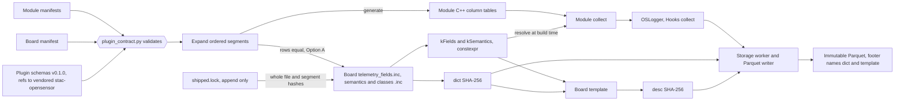

# Sensor plugins

| Item | Value |
| --- | --- |
| Title | OpenSensor plugin contract |
| Identifier | `https://walkthru-earth.github.io/opensensor-space-firmware/plugins/v0.1.0/module.json` |
| Follows | [stac-opensensor](https://github.com/walkthru-earth/stac-opensensor) v0.1.0, vendored in [`tools/stac_opensensor/v0.1.0/`](../../../tools/stac_opensensor/v0.1.0/) |
| Maturity | Pilot. Steps 1 to 3 of section 11 landed and both boards pass the byte gate |
| Tracking | [#17](https://github.com/walkthru-earth/opensensor-space-firmware/issues/17), [#111](https://github.com/walkthru-earth/opensensor-space-firmware/issues/111) |

The firmware can already log any numeric reading. The logger, writer, sync
and location code know nothing about air quality. What ties a Thing to air
today is that each board writes its sensors by hand into its own contract
files. This proposal puts one declarative, versioned contract in front of
those files, in the layout stac-opensensor uses. Small manifests declare each
sensor module and each board. Versioned JSON Schemas validate them. A host
gate then generates or byte-checks the files the firmware compiles.

Nothing here changes a wire or file format. The hashed `telemetry_fields.inc`
bytes, `dict`, `desc`, append-only `field_id` and the NVS rules stay exactly
as they are. Names use the neutral `os_` spelling from Phase 2 of #111, with
today's `aq_` name shown where code is cited.

## What landed

Steps 1 to 3 of section 11 are in. The firmware compiles exactly what it did
before. Only host files are new.

| Part | Path |
| --- | --- |
| Schemas, v0.1.0 | [`v0.1.0/module.json`](v0.1.0/module.json), [`v0.1.0/board.json`](v0.1.0/board.json), [`v0.1.0/lock.json`](v0.1.0/lock.json) |
| Examples | [`examples/bme280.module.json`](examples/bme280.module.json), [`examples/weather.board.json`](examples/weather.board.json) |
| Logger segments | [`firmware/common/logger/system.module.json`](../../../firmware/common/logger/system.module.json) |
| Shared sensor modules | `firmware/common/sensors/modules/<id>/module.json` for `pmsa003`, `pms5003t`, `ltr553`, `sht20`, `max17048` and `battery_health` |
| Board local modules | CoreS3 `bringup/modules/` (`m5_imu`, `axp2101`, `bm8563`, `ft6336`), Waveshare `logger/modules/waveshare` |
| Board manifests and locks | `board.json` and `shipped.lock` beside each board `telemetry_fields.inc` |
| Gate | [`tools/plugin_contract.py`](../../../tools/plugin_contract.py), `pixi run plugin-contract`, proved by mutation in `pixi run plugin-contract-test`, part of `pixi run gate` |
| Changes | [CHANGELOG](CHANGELOG.md) |

Four details differ from the proposal text below, and the schemas win.

- `status` names the status column only. Its codes are that column's
  `classification:classes`, so the CLASS rows and the template have one
  source.
- A board may set `class_subsets`, a map from column to the class names it
  ships. Waveshare has no RTC, so its `clock_status` lists `none`, `host` and
  `network` from the logger's four.
- `battery_health` is a shared module under `firmware/common/sensors/modules/`,
  because the derivation lives in common code.
- Section 11 plans one PR per step. Steps 1 to 3 landed together in #121,
  since step 1 alone would gate examples only and step 2 alone could not
  prove its locks against manifests.

## 1. Where the firmware stands

| Already neutral | Where |
| --- | --- |
| FIELD X-macro dictionary, one row of name, type, procedure, unit, validity, LIVE key and decimals | Board `telemetry_fields.inc`, expanded in [CoreS3 `telemetry_contract.h`](../../../firmware/esp-idf-cores3/bringup/telemetry_contract.h) lines 68 to 73 and 122 to 134 |
| `oslogger::Config` and `Hooks`, with one `collect(Row&, now, scheduled, context)` callback | [`os_logger.h`](../../../firmware/common/logger/src/os_logger.h) lines 35 to 119 |
| `ossync::ServiceConfig`, board sdkconfig defaults, bus agnostic drivers | `Config::sync`, each board app, [`firmware/common/sensors/`](../../../firmware/common/sensors/) |
| A non air table already writes valid files | Soil fixture in [`test_footer.cpp`](../../../firmware/common/logger/tests/test_footer.cpp) lines 410 to 530 |

| Still leaks | Where and effect |
| --- | --- |
| No circular mean, no counter delta | `enum class Aggregate` in [`column_semantics.h`](../../../firmware/common/src/column_semantics.h) lines 34 to 41 mirrors the stac-opensensor enum. Both `telemetry_semantics.inc` files say at lines 78 to 80 that counters use `point` for this reason (#83, bridge open question 17) |
| Hand written collect | CoreS3 [`telemetry_logger.cpp`](../../../firmware/esp-idf-cores3/bringup/telemetry_logger.cpp) lines 30 to 115, Waveshare [`main.cpp`](../../../firmware/esp-idf-waveshare-sim7670g/logger/main.cpp) lines 103 to 116. `apply_pms` sits in the Waveshare contract header at line 238 |
| Rows copied by hand | The FIELD system head (10 rows), runtime (12), clock close (2), clock anchor (2) and location (4) segments are byte identical on both boards. Of 52 shared SEM names, 30 rows are identical and the other 22 differ only in what the sensor owns (vendor, model, range, `valid_when`) |
| Same name, different sensor | `ambient_temperature_c` is `sht20_unresolved` with 2 decimals on CoreS3 and `pms5003t` with 1 decimal on Waveshare, so a module must own its whole row |
| One sensor identity slot | `sensor_vendor`, `sensor_model`, `sensor_serial` in [`device_config.h`](../../../firmware/common/runtime/src/device_config.h) lines 53 to 56. NVS keys must not change, so per module identity means new keys beside them |
| `aq_` names | Only a few host test file stems are left. The CMake helpers are `os_` since #115, the build variables and manifests since #118, the board components since #122, the logger sources since #123 and the location, power, console and sensor files since #124 |

## 2. One contract, laid out like stac-opensensor

| Piece | Proposed path | Role |
| --- | --- | --- |
| Spec README with field tables | `docs/shared/plugins/README.md` (this file moves there when accepted) | What each manifest field means |
| Module schema | `docs/shared/plugins/v0.1.0/module.json` | Validates one Sensor Module Manifest |
| Board schema | `docs/shared/plugins/v0.1.0/board.json` | Validates one Board Manifest |
| Examples | `docs/shared/plugins/examples/` | One module and one board, checked by the gate |
| Changelog | `docs/shared/plugins/CHANGELOG.md` | Keep a Changelog, semver |
| Module manifests | `firmware/common/sensors/modules/<id>/module.json`, board local ones under the board app | One per sensor model |
| Board manifests | `firmware/esp-idf-<board>/<variant>/board.json` | One per board variant |
| Gate | `tools/plugin_contract.py`, `pixi run plugin-contract-test`, added to `pixi run gate` | Validate, then generate or byte-check |

The schemas resolve offline. Like `board_template.validator()`, the gate loads
the vendored stac-opensensor schemas into a `referencing` registry, so a
`$ref` to a stac-opensensor `$id` never touches the network.

## 3. Sensor Module Manifest

| Field | Type | Description |
| --- | --- | --- |
| type | `"OpenSensorModule"` | **REQUIRED** |
| module_version | `"0.1.0"` | **REQUIRED**. Plugin schema version |
| stac_opensensor | `"0.1.0"` | **REQUIRED**. stac-opensensor version whose vocabulary the columns use |
| id | string | **REQUIRED**. Module id, `^[a-z][a-z0-9_]{0,31}$` |
| procedure | string | **REQUIRED**. `$ref` to stac-opensensor `opensensor:procedure`. Default FIELD procedure for every column of the module |
| vendor, model | string | Default SEM `sensor_vendor` and `sensor_model`, copied to every SEM row of the module. Absent means `""`, as on the system rows |
| buses | \[string] | **REQUIRED**. `i2c`, `spi`, `uart`, `adc`, `pcnt`, `gpio` or `onewire` |
| requires | object | Capabilities the board must grant, such as `i2c_address`, `pcnt_units`, `adc_channels`, `uart_baud` |
| settle_s | number | `$ref` to `opensensor:settle_s`. Warm-up for the whole sensor |
| init_errors | \[string] | Ordered names of the module's `InitError` values |
| status | object | `{"column": <name>}`. The status column of the module. Its codes are that column's `classification:classes` |
| segments | Map\<string, \[Column]> | **REQUIRED**. Named, ordered column lists, such as `core` and `received` |

A Column object is a stac-opensensor column plus a `firmware` member.

| Column field | Source | Maps to |
| --- | --- | --- |
| name, unit (UCUM), roles, `cf:standard_name`, `classification:classes` | Table and classification vocabularies | Template column, SEM `ucum`, `role` and `cf_standard_name`, CLASS rows |
| `opensensor:property`, `opensensor:aggregate`, `opensensor:plausible_range`, `opensensor:valid_when`, `opensensor:settle_s` | `$ref` to stac-opensensor `schema.json#/definitions/column` | SEM `property`, `aggregate`, `plausible_min`, `plausible_max`, `valid_when`, `settle_s` |
| `opensensor:procedure`, optional | Same `$ref` | FIELD `procedure` when it differs from the module default |
| `opensensor:derived`, optional | Same `$ref` | The board `kDerived` entry for a `modelResult` column, such as Waveshare `pm25_batch_candidate_ug_m3` in `telemetry_contract.h` line 437 |
| `firmware.type`, `firmware.unit`, `firmware.validity`, `firmware.live_key`, `firmware.decimals` | Plugin schema. `live_key` uses the stac-opensensor template `live_keys` pattern | FIELD `physical_type`, `unit`, `validity`, `live_key`, `decimals` |
| `firmware.vendor`, `firmware.model`, optional | Plugin schema | SEM `sensor_vendor` and `sensor_model` when they differ from the module default. `""` clears them |

The module procedure is a default. A column overrides it with its own
`opensensor:procedure`, because today's segments mix procedures. Examples are
`system.head` (`logger`, `identity`, `clock`), `system.location` (`h3_grid`,
`h3_grid_center`) and CoreS3 rows 37 to 39 (`m5_imu_aux` inside `m5_imu`).
The template already carries a procedure per column, and
`tools/board_template.py` line 151 checks it per column against FIELD, so the
mapping stays one to one.

`opensensor:field_id`, `opensensor:scale` and `title` are forbidden in a
manifest column, matching `template.json`. The board position sets the id. So
a manifest column maps one to one onto a template `table:columns` entry, and
the board template stays the place where the profile role rules are checked.

The schema reuses rather than redefines.

```json
{
  "$schema": "http://json-schema.org/draft-07/schema#",
  "$id": "https://walkthru-earth.github.io/opensensor-space-firmware/plugins/v0.1.0/module.json#",
  "title": "OpenSensor Sensor Module Manifest",
  "type": "object",
  "required": ["type", "module_version", "stac_opensensor", "id", "procedure", "buses", "segments"],
  "properties": {
    "type": {"const": "OpenSensorModule"},
    "module_version": {"const": "0.1.0"},
    "stac_opensensor": {"const": "0.1.0"},
    "procedure": {"$ref": "https://walkthru-earth.github.io/stac-opensensor/v0.1.0/schema.json#/definitions/column/properties/opensensor:procedure"},
    "settle_s": {"$ref": "https://walkthru-earth.github.io/stac-opensensor/v0.1.0/schema.json#/definitions/column/properties/opensensor:settle_s"},
    "segments": {
      "type": "object",
      "additionalProperties": {"type": "array", "minItems": 1, "items": {"$ref": "#/definitions/column"}}
    }
  },
  "definitions": {
    "column": {
      "allOf": [
        {"$ref": "https://walkthru-earth.github.io/stac-opensensor/v0.1.0/schema.json#/definitions/column"},
        {"required": ["name", "roles", "firmware"],
         "not": {"anyOf": [{"required": ["opensensor:field_id"]}, {"required": ["opensensor:scale"]}, {"required": ["title"]}]},
         "properties": {"firmware": {"$ref": "#/definitions/firmware"}}}
      ]
    },
    "firmware": {
      "type": "object",
      "required": ["type", "unit", "validity", "live_key", "decimals"],
      "properties": {
        "type": {"enum": ["Int32", "Int64", "Float", "ByteArray"]},
        "unit": {"type": "string", "minLength": 1},
        "validity": {"type": "string", "pattern": "^[a-z_][a-z0-9_]*$"},
        "vendor": {"type": "string"},
        "model": {"type": "string"},
        "live_key": {"anyOf": [
          {"const": ""},
          {"$ref": "https://walkthru-earth.github.io/stac-opensensor/v0.1.0/template.json#/properties/firmware/properties/live_keys/additionalProperties"}
        ]},
        "decimals": {"type": "integer", "minimum": 0, "maximum": 9}
      },
      "additionalProperties": false
    }
  }
}
```

The excerpt leaves out `id`, `buses`, `requires`, `status` and the
`name` pattern. Those follow the tables above.

## 4. Board Manifest

| Field | Type | Description |
| --- | --- | --- |
| type | `"OpenSensorBoard"` | **REQUIRED** |
| board_version | `"0.1.0"` | **REQUIRED**. Plugin schema version |
| board | string | **REQUIRED**. Board slug, as in `docs/shared/templates/<board>/` |
| schema | string | **REQUIRED**. Firmware schema name, the template `id` |
| sample_interval_s | number | **REQUIRED**. Written to the template `opensensor:sample_interval_s`, must equal the `oslogger::Config` value |
| title, keywords | string, \[string] | Template title and keywords. CoreS3 and Waveshare keep "air quality" |
| local_modules | \[path] | Manifests that live in the board app, such as the CoreS3 M5 IMU, AXP2101, BM8563 and FT6336 and the Waveshare `pms_identity` segment |
| segments | \[\{module, segment\}] | **REQUIRED**. Ordered segment list. `module` is a module id or `system`. Each segment appears at most once |
| class_subsets | Map\<string, \[string]> | Class names a board ships for a column, in the module's value order. Absent means all |

Segments, not one block per module, because field ids are append only. A
module that grows later adds a new segment at the end. Both boards already
decompose this way.

| CoreS3 | Segment | Waveshare | Segment |
| --- | --- | --- | --- |
| 1 to 10 | `system.head` | 1 to 10 | `system.head` |
| 11 to 29 | `pmsa003.core` | 11 to 22 | `pms5003t.core` |
| 30 to 58 | `m5_imu`, `ltr553`, `axp2101`, `bm8563`, `ft6336` `.core` | 23 to 25 | `waveshare.pms_identity`, board local |
| 59 to 70 | `system.runtime` | 26 to 32 | `pms5003t.tail` |
| 71 to 72 | `sht20.core` | 33 to 35 | `max17048.core` |
| 73 to 74 | `system.clock_close` | 36 to 49 | `system.runtime`, `system.clock_close` |
| 75 | `pmsa003.received` | 50 | `pms5003t.received` |
| 76 to 77 | `system.clock_anchor` | 51 to 56 | `system.clock_anchor`, `system.location` |
| 78 to 81 | `system.location` | 57 to 62 | `max17048.v5`, `battery_health.core` |

The `system` segments belong to the logger, which fills those columns by name,
so their manifest lives at `firmware/common/logger/system.module.json`.
`waveshare.pms_identity` is not a sensor. It is a board local segment with
three procedures (`owner_provisioned_identity`,
`airgradient_20260408_count_candidate_v1`, `batch_candidate_gate`), declared
in the Waveshare app with per column procedures.

## 5. Generated or gated artifacts

`tools/plugin_contract.py` runs four steps.

1. Validate every module and board manifest against its schema.
2. Check cross rules a schema cannot express. Column names are unique on a
   board, LIVE keys keep one key to one column across boards
   (`tools/live_key_fixture.py`), the board stays within `kMaxColumns` 96,
   and the board file matches its `shipped.lock` (below). The 480 byte LIVE
   cap stays with the LIVE fixture tests.
3. Expand each board's segment list into FIELD, SEM and CLASS rows, the
   template columns, instruments, LIVE keys and unit labels. Step 4 of
   section 11 adds the per module C++ column tables and status codes.
4. Byte-check, as below.

| Option | What the firmware compiles | Gate |
| --- | --- | --- |
| A. Gate | The checked-in board `telemetry_fields.inc`, `telemetry_semantics.inc` and `telemetry_classes.inc`, unchanged | The generated rows equal the board file rows in order, and the whole `telemetry_fields.inc` is hashed against the lock. A new board gets its files written once, then they are frozen like any other |
| B. Generate | Rows generated from manifests at build time | The generated table equals a frozen `.inc` copy byte for byte |

**Decided 2026-10-27, Option A.** The pinned `kDictionaryUri` exists so that the
bytes behind the link are the bytes the image compiled and hashed. Option A
keeps that, needs no build change and lets every migration step land as a
host only PR. Option B makes the hashed file a copy of what the image really
compiles, and the board comment prose, which is hashed into `dict`, cannot
come from manifests without a special case.

### The append only baseline, `shipped.lock`

Rows equal to manifests prove nothing about history. Someone could edit a
shipped segment in both the manifest and the `.inc`. So each board variant
keeps a checked-in `shipped.lock` next to its `telemetry_fields.inc`, with
one entry per released `dict`.

```json
{
  "board": "m5stack-cores3",
  "releases": [
    {"dict": "<SHA-256 of the raw telemetry_fields.inc, equal to dict>",
     "rows": 81,
     "segments": [
       {"module": "system", "segment": "head", "first": 1, "rows": 10, "sha256": "<SHA-256 of these FIELD rows as written>"},
       {"module": "pmsa003", "segment": "core", "first": 11, "rows": 19, "sha256": "..."}
     ]}
  ]
}
```

The gate enforces five rules.

- The SHA-256 of the current `telemetry_fields.inc` equals the newest
  release `dict`. Any byte change fails, a comment only edit included,
  because the file hash moves.
- A new release keeps every segment of the previous one at the same `first`,
  `rows` and `sha256`, and adds segments only after the last row. A reorder,
  a removal or an edit inside a shipped segment fails.
- An owner approved break is the one exception, and it is per segment. A
  release that carries `"baseline": {"reason": "...", "migration":
  "<heading>", "segments": [{"module": "...", "segment": "..."}]}` may edit
  only the shipped segments it lists, and it must edit each one it lists.
  Every other shipped segment keeps its `rows` and `sha256`. All shipped
  segments stay in order ahead of any new one, and the release may not drop
  rows. `migration` is the exact text of a `## ` heading that starts a line
  in the [mobile migration notes](../mobile-migration.md), so a `### `
  subheading never matches, and that entry must name the release `dict`. A
  missing entry or a dict the entry never names fails.
  The first release cannot be a baseline. Earlier releases stay in the lock
  unchanged, so the file is still append only. A baseline is a contract
  break, so it needs a matched app build and a reflash (owner decision 14).
- A new release lands with a newest first entry in
  [mobile migration notes](../mobile-migration.md) that names the new `dict`.
- Releases are append only. The gate also reads the base branch lock
  (`git show origin/main:<path>/shipped.lock`, or the PR base in CI) and
  requires every earlier entry to be byte identical, so only new entries may
  be appended. A lock path absent at the base is treated as new, and the gate
  prints a notice naming it, so a moved board directory shows in the log. On
  a push to main the base is main itself, so this check is vacuous there by
  design. It bites on pull requests.

Two existing checks already catch an inconsistent `dict` move today.
`tools/build-idf-board.sh` lines 20 to 23 fails when the digest header and the
file disagree, and `pixi run pinned-uris-test` fails when the pinned commit
does not hold bytes that hash to `dict`. Neither knows what shipped, so an
edit with a regenerated header and a fresh pin passes both. The lock is the
missing baseline. `pixi run plugin-contract-test` without it would not guard
`dict` at all.

What stays fixed under either option.

- `dict` stays the SHA-256 of the raw board `.inc` bytes, checked by
  `tools/build-idf-board.sh` lines 20 to 23, the contract test and now the
  lock.
- `desc` stays the SHA-256 of the template bytes `tools/board_template.h`
  builds from those same files.
- `field_id` stays the 1-based position, append only from the Thing baseline.
- NVS namespaces, keys, types and partition offsets do not move.
- Moving an existing board to manifests must reproduce today's bytes. If a
  value cannot round trip, such as a plausible range spelled `0.5` against
  `.5`, the gate fails and the generator gets fixed, never the board file.

## 6. Extension points

Every kind follows one pattern. A versioned schema under
`docs/shared/plugins/vX.Y.Z/`, an example, a gate step in
`plugin_contract.py` and a CHANGELOG line. A new kind is a new schema plus a
gate, never ad hoc code.

| Kind | Manifest | Contract it feeds |
| --- | --- | --- |
| Sensor module | `module.json` | FIELD, SEM and CLASS rows, module C++ tables |
| Board | `board.json` | Segment order, template title, keywords, sample interval |
| Transport, later | `transport.json` | For example a LoRa uplink, as an `ossync` option set |
| Uploader, later | `uploader.json` | For example source.coop, its prefix and credential source, never the secret |

## 7. Spec flow and versioning

New semantics land upstream first. Circular mean and counter delta are a
stac-opensensor change, raised through the bridge "Open questions" process
(question 17 already asks it). Then the vendored copy in
`tools/stac_opensensor/` is refreshed, then the plugin schema moves its
`stac_opensensor` const and `$ref` URLs to the new version, then
`column_semantics.h` and `aggregate_name()` in `tools/board_template.h` gain
the enumerators. Mobile already reads an unknown aggregate as `point`.

The plugin schemas use semver. Before 1.0.0 a breaking change bumps the minor
and anything else the patch. Maturity follows the STAC extension labels.
Pilot now that both boards pass the byte gate, Candidate once a third board
ships with a dated bench record, Stable by owner decision.

| Change | `dict` | `desc` | Plugin schema |
| --- | --- | --- | --- |
| A FIELD value in a shipped segment (name, type, unit label, validity, LIVE key, decimals) | Forbidden by the lock. Add a new segment instead, or an owner approved `baseline` release | | |
| A new segment appended to a board | New on that board, plus a lock release | New, the template carries `dict` | No change |
| Board `.inc` comment prose | New, comments are hashed, plus a lock release | New | No change |
| SEM or class values (property, aggregate, range, `valid_when`, settle, roles, vendor) | Same | New on every board using that segment, the gate lists them | No change |
| A new optional manifest field or extension kind | Same | Same | Patch |
| A new stac-opensensor version adopted | Same until a board uses a new value | Same until then | Minor, following upstream |
| A manifest field renamed, removed or made required | Same if output bytes match | Same | Minor before 1.0.0, major after |

Any `dict` change also follows the two pin procedure in the
[templates README](../templates/README.md), a new LIVE fixture digest, the LIVE
table in [the sync protocol](../ble-sync-protocol.md) and a newest first entry in
[mobile migration notes](../mobile-migration.md). A new board is always a new
dictionary.

## 8. Where the contract lives

In this repo, under `docs/shared/plugins/`, next to the board templates it
feeds and gated by the same `pixi run gate`. The owner decided on 2026-10-27
that it stays here.

## 9. Worked example, a weather board

A hypothetical ESP32-S3 weather Thing with a BME280, a cup anemometer with a
wind vane and a tipping bucket rain gauge, plus the existing MAX17048 module.

```json
{
  "type": "OpenSensorBoard",
  "board_version": "0.1.0",
  "board": "example-weather-s3",
  "schema": "example-weather-s3-telemetry-v1",
  "sample_interval_s": 10,
  "title": "Example weather Thing, BME280, cup anemometer, rain gauge",
  "keywords": ["weather", "wind", "rainfall", "air pressure"],
  "segments": [
    {"module": "system", "segment": "head"},
    {"module": "bme280", "segment": "core"},
    {"module": "cup_anemometer", "segment": "core"},
    {"module": "tipping_bucket", "segment": "core"},
    {"module": "max17048", "segment": "core"},
    {"module": "system", "segment": "runtime"},
    {"module": "system", "segment": "clock_close"},
    {"module": "system", "segment": "clock_anchor"},
    {"module": "system", "segment": "location"}
  ]
}
```

The board manifest stays at plugin schema `0.1.0`. Only the anemometer
module needs the two new aggregates, so it validates only against a module
schema that follows a stac-opensensor release with them. `0.2.0` below marks
that future version.

```json
{
  "type": "OpenSensorModule",
  "module_version": "0.2.0",
  "stac_opensensor": "0.2.0",
  "id": "cup_anemometer",
  "procedure": "cup_anemometer",
  "vendor": "Generic",
  "model": "reed cup anemometer and vane",
  "buses": ["pcnt", "adc"],
  "requires": {"pcnt_units": 1, "adc_channels": 1},
  "init_errors": ["pcnt_unavailable", "adc_unavailable"],
  "status": {"column": "anemometer_status"},
  "segments": {"core": [
    {"name": "anemometer_status", "unit": "{code}", "roles": ["qualityInformation"],
     "opensensor:property": "urn:walkthru-earth:property:anemometer_status",
     "opensensor:aggregate": "mode",
     "classification:classes": [
       {"value": 0, "name": "ok"},
       {"value": 1, "name": "vane_out_of_range"},
       {"value": 2, "name": "missing", "nodata": true}
     ],
     "firmware": {"type": "Int32", "unit": "code", "validity": "always", "live_key": "", "decimals": 0}},
    {"name": "wind_speed_m_s", "unit": "m/s", "roles": ["physicalMeasurement"],
     "cf:standard_name": "wind_speed",
     "opensensor:property": "http://vocab.nerc.ac.uk/standard_name/wind_speed/",
     "opensensor:aggregate": "mean", "opensensor:plausible_range": [0, 75],
     "opensensor:valid_when": {"column": "anemometer_status", "equals": 0},
     "firmware": {"type": "Float", "unit": "m/s", "validity": "anemometer_ok", "live_key": "ws", "decimals": 1}},
    {"name": "wind_gust_m_s", "unit": "m/s", "roles": ["physicalMeasurement"],
     "cf:standard_name": "wind_speed_of_gust",
     "opensensor:property": "http://vocab.nerc.ac.uk/standard_name/wind_speed_of_gust/",
     "opensensor:aggregate": "maximum", "opensensor:plausible_range": [0, 100],
     "opensensor:valid_when": {"column": "anemometer_status", "equals": 0},
     "firmware": {"type": "Float", "unit": "m/s", "validity": "anemometer_ok", "live_key": "wg", "decimals": 1}},
    {"name": "wind_direction_deg", "unit": "deg", "roles": ["physicalMeasurement"],
     "cf:standard_name": "wind_from_direction",
     "opensensor:property": "http://vocab.nerc.ac.uk/standard_name/wind_from_direction/",
     "opensensor:aggregate": "circular_mean", "opensensor:plausible_range": [0, 360],
     "opensensor:valid_when": {"column": "anemometer_status", "equals": 0},
     "firmware": {"type": "Float", "unit": "deg", "validity": "anemometer_ok", "live_key": "wd", "decimals": 0}},
    {"name": "wind_pulses_total", "unit": "{count}", "roles": ["qualityInformation"],
     "opensensor:property": "urn:walkthru-earth:property:anemometer_pulse_count",
     "opensensor:aggregate": "delta",
     "firmware": {"type": "Int64", "unit": "count", "validity": "always", "live_key": "", "decimals": 0}}
  ]}
}
```

The gate expands that segment into these rows of the new board's files. The
module `vendor` and `model` are copied to every SEM row.

```text
FIELD(anemometer_status, Int32, cup_anemometer, "code", always, "", 0)
FIELD(wind_speed_m_s, Float, cup_anemometer, "m/s", anemometer_ok, "ws", 1)
FIELD(wind_gust_m_s, Float, cup_anemometer, "m/s", anemometer_ok, "wg", 1)
FIELD(wind_direction_deg, Float, cup_anemometer, "deg", anemometer_ok, "wd", 0)
FIELD(wind_pulses_total, Int64, cup_anemometer, "count", always, "", 0)

SEM(anemometer_status, "{code}", qualityInformation, "", mode, , , 0, "", "urn:walkthru-earth:property:anemometer_status", "Generic", "reed cup anemometer and vane")
SEM(wind_speed_m_s, "m/s", physicalMeasurement, "wind_speed", mean, 0, 75, 0, "anemometer_status == 0", "http://vocab.nerc.ac.uk/standard_name/wind_speed/", "Generic", "reed cup anemometer and vane")
SEM(wind_gust_m_s, "m/s", physicalMeasurement, "wind_speed_of_gust", maximum, 0, 100, 0, "anemometer_status == 0", "http://vocab.nerc.ac.uk/standard_name/wind_speed_of_gust/", "Generic", "reed cup anemometer and vane")
SEM(wind_direction_deg, "deg", physicalMeasurement, "wind_from_direction", circular_mean, 0, 360, 0, "anemometer_status == 0", "http://vocab.nerc.ac.uk/standard_name/wind_from_direction/", "Generic", "reed cup anemometer and vane")
SEM(wind_pulses_total, "{count}", qualityInformation, "", delta, , , 0, "", "urn:walkthru-earth:property:anemometer_pulse_count", "Generic", "reed cup anemometer and vane")
```

The BME280 and rain gauge manifests follow the same shape and are not shown.
The checked-in [`examples/`](examples/) keep to schema `0.1.0`, so they carry
the BME280 and MAX17048 only and the gate validates and expands them.
The board gets its own `dict`, `desc`, `shipped.lock`, template, pinned URIs,
LIVE fixture, sync protocol LIVE rows (`ws`, `wg`, `wd` and whatever keys
the other modules declare), mobile migration entry and bench record. The gate
checks the column count and LIVE size against the caps. CoreS3 and Waveshare
files and digests do not change.

## 10. What the generator emits in C++

This part is secondary. It is what step 3 of the gate generates next to each
manifest, or checks when the header already exists. It follows the root
[AGENTS.md](../../../AGENTS.md) rules. Columns resolve at build time, tables are
`static constexpr`, errors are an error only enum and nothing allocates.

```cpp
// GENERATED from firmware/common/sensors/modules/cup_anemometer/module.json
namespace ossensor::cup_anemometer {
enum class [[nodiscard]] InitError : std::uint8_t { pcnt_unavailable, adc_unavailable };
enum class Column : std::uint8_t { status, wind_speed, wind_gust, wind_direction, pulses_total };
inline constexpr std::array<std::string_view, 5> kColumns{
    "anemometer_status", "wind_speed_m_s", "wind_gust_m_s", "wind_direction_deg", "wind_pulses_total"};
inline constexpr std::int32_t kStatusOk = 0;
inline constexpr std::int32_t kStatusVaneOutOfRange = 1;
inline constexpr std::int32_t kStatusMissing = 2;
} // namespace ossensor::cup_anemometer
```

The hand written module code uses that header. `ossensor::resolve` is a
`consteval` lookup that maps `kColumns` to board column indices and stops the
build when a name is missing. The board hook loops over a `static constexpr`
module table, so the logger and `Hooks::collect` keep their signatures.

```cpp
struct Module {
  std::string_view procedure;
  std::expected<void, InitErrorCode> (*init)(void *context);
  void (*collect)(oslogger::Row &row, std::int64_t now_us, void *context);
  void *context;
};

constinit cup_anemometer::Context wind{
    .io = &kWindIo,
    .slots = ossensor::resolve(cup_anemometer::kColumns, std::span{telemetry::kFields}),
};

static constexpr std::array kModules{
    Module{.procedure = "cup_anemometer", .init = cup_anemometer::init,
           .collect = cup_anemometer::collect, .context = &wind},
};

void collect(oslogger::Row &row, std::int64_t now, std::int64_t, void *) {
  for (const auto &module : kModules)
    module.collect(row, now, module.context);
}
```

`collect` stays on the main loop. Pulses are counted in PCNT hardware and read
there. A failed `init` leaves the module columns null and sets its status, so
sampling never stops.

## 11. Migration plan

One PR per step, after the Phase 2 renames. No step through 7 changes a wire
or file format, `dict` or `desc`.

| Step | PR | Proof |
| --- | --- | --- |
| 1 | `docs/shared/plugins/` README, CHANGELOG, v0.1.0 schemas, examples, `plugin_contract.py` and its pixi task | Validates examples only, no firmware file touched |
| 2 | `system.module.json`, and a `shipped.lock` for each board at today's `dict` | Both boards contain its FIELD and SEM rows verbatim, both locks match the current files |
| 3 | Sensor and board local manifests, `board.json` for both boards | Full FIELD, SEM and CLASS reproduction including per column procedures, status constants match |
| 4 | Generated module headers and `os_sensor_module.h`, with a host test | No board source changes |
| 5 | Waveshare `collect` moves to modules | Row equality fixture for the same inputs, both boards build |
| 6 | CoreS3 `collect` moves to modules | Same |
| 7 | Generator write mode, new boards only | Refuses to write an existing board file |
| 8 | Aggregates, upstream first (section 7) | Existing templates byte identical |
| 9 | The weather board, if wanted | New dictionary, existing boards unchanged |

Steps 5 and 6 touch firmware, so both boards build and get proportional
readback before any hardware claim.

## 12. Flow



## Decisions and defaults, 2026-10-27

Items 1, 4, 7 and 8 are owner decisions dated 2026-10-27. Items 2, 3, 5 and 6
are the proposal defaults, adopted pending owner review.

1. Owner decision. Option A. Board files stay frozen and gated, never
   generated at build time.
2. (proposal default) Raise `circular_mean` and `delta` in stac-opensensor
   upstream, under bridge question 17, with those names.
3. (proposal default) Running counters stay on `point` for now. Moving them
   is a later, separate decision, since it moves `desc` on both boards.
4. Owner decision. The plugin contract stays in this repo.
5. (proposal default) The schema `$id` uses GitHub Pages for this repo. The
   gate never fetches it.
6. (default pending owner review) Two identical sensors on one Thing are
   deferred. Until the owner decides, each segment appears at most once per
   board, and the gate enforces it.
7. Owner decision. No NVS identity changes. The single sensor slot stays as
   it is.
8. Owner decision. A board lists every module it may carry, with absent ones
   null.
