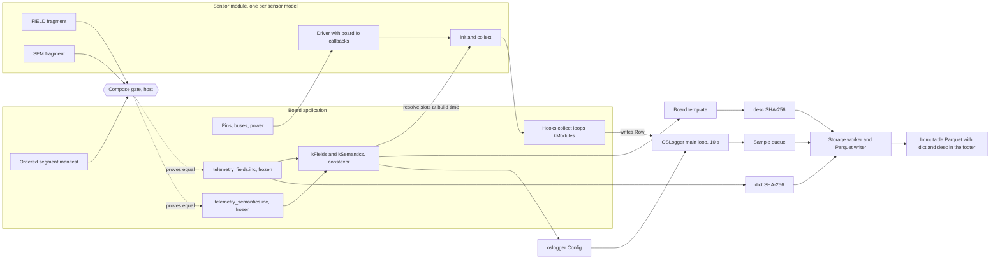

# Sensor plugins (proposal)

Status. Proposal only, tracked under epic
[#111](https://github.com/walkthru-earth/opensensor-space-firmware/issues/111).
Nothing here is implemented. No wire or file format changes in this document,
and `dict` and `desc` stay where they are on both boards.

The firmware already logs any numeric measurement. The logger, writer, sync and
location code do not know what air quality is. What still ties a Thing to air
quality is how each board spells its sensors, by hand, inside its own contract
files. This proposal turns each sensor into a module that brings its own
driver, collect step and dictionary rows. A board then composes an ordered list
of modules plus the shared system rows. Composition happens at build time
only, with no runtime registry and no heap.

The names below use the neutral `os_` spelling that Phase 2 of #111 gives the
code. Where code is cited, the current `aq_` name is shown as well, for example
`os_logger.h` (today `aq_logger.h`).

## 1. What is neutral today and what still leaks

### Already neutral

| Piece | Where | Why it is neutral |
| --- | --- | --- |
| FIELD dictionary | Board `telemetry_fields.inc`, expanded by the X-macros in [CoreS3 `telemetry_contract.h`](../../firmware/esp-idf-cores3/bringup/telemetry_contract.h) lines 68 to 73 and 122 to 134 | A row is name, type, procedure, unit, validity, LIVE key and decimals. Nothing in the format assumes air |
| Logger row | `opensensor::NumericSample` in [`numeric_sample.h`](../../firmware/common/src/numeric_sample.h) lines 21 to 23 | `integer`, `counter` and `number` write by column index |
| Logger config and hooks | `oslogger::Config` and `oslogger::Hooks` in [`os_logger.h`](../../firmware/common/logger/src/aq_logger.h) (today `aq_logger.h`) lines 35 to 84 and 87 to 119 | The board passes the field table and one `collect(Row&, now, scheduled, context)` callback at line 91. The logger fills runtime, clock and location columns by name |
| Sync config | `ossync::ServiceConfig` through `Config::sync` | BLE and LAN options, no board names |
| Board sdkconfig defaults | Each board application | Flash, PSRAM, console and DFS stay per board |
| Shared drivers | [`firmware/common/sensors/`](../../firmware/common/sensors/) | Bus agnostic `*Io` callbacks, no heap, no bus locks, raw values plus validity |
| Semantics checks | [`column_semantics.h`](../../firmware/common/src/column_semantics.h) | `aligned`, `well_formed` and `board_neutral_property` hold for any column set |
| Non air proof | Soil fixture in [`test_footer.cpp`](../../firmware/common/logger/tests/test_footer.cpp) lines 410 to 445 | A four runtime column plus `soil_moisture_pct` and `soil_temperature_c` table writes a valid footer with a 30 s period and an `SL-` prefix, and the test asserts no column starts with `pm` |

### Still leaks air quality or a single board shape

| Leak | Where | Effect |
| --- | --- | --- |
| Aggregate kinds | `enum class Aggregate` in [`column_semantics.h`](../../firmware/common/src/column_semantics.h) lines 34 to 41 has `mean, minimum, maximum, sum, point, mode` | No circular mean for wind direction and no counter delta for rain or energy. Both boards note at `telemetry_semantics.inc` lines 78 to 80 that running counters use `point` because the profile has no counter delta. #83 records that the stac-opensensor enum needs a spec addition before a weather board |
| Hand written collect | CoreS3 `collect()` in [`telemetry_logger.cpp`](../../firmware/esp-idf-cores3/bringup/telemetry_logger.cpp) lines 30 to 113, Waveshare `collect()` in [`main.cpp`](../../firmware/esp-idf-waveshare-sim7670g/logger/main.cpp) lines 103 to 116 | Each board maps its sensors to enum indices by hand. The Waveshare PMS mapping `apply_pms` sits in the board contract header at line 238, so it cannot be reused |
| Duplicated SEM rows | Both `telemetry_semantics.inc` files | Of 52 shared column names, 30 SEM rows are byte identical (identity, clock, runtime, storage, H3) and the other 22 differ only in what the sensor owns (vendor, model, plausible range, `valid_when`). CoreS3 lines 81 to 90, 141 to 152 and 155 to 163 repeat Waveshare lines 81 to 90 and 116 to 136 |
| Duplicated FIELD rows | Both `telemetry_fields.inc` files | The system head (10 rows), runtime (12), clock close (2), clock anchor (2) and location (4) segments are byte identical on both boards, copied by hand |
| Same name, different sensor | `ambient_temperature_c` is `sht20_unresolved` with 2 decimals at CoreS3 position 71, and `pms5003t` with 1 decimal at Waveshare position 28 | Procedure, validity and decimals belong to the sensor, not the column name. A module must own its whole FIELD row |
| Single sensor identity | `Settings::sensor_vendor`, `sensor_model`, `sensor_serial` and `sensor_batch_candidate` in [`device_config.h`](../../firmware/common/runtime/src/device_config.h) lines 53 to 56, `SensorPolicy` at lines 85 to 92 | One identity slot per Thing, shaped for one PMS sensor. NVS keys must not change, so a multi sensor Thing needs new keys added beside them |
| Vendor deny list | `kProcedureWords` in [`column_semantics.h`](../../firmware/common/src/column_semantics.h) lines 159 to 164 | Keeps vendor words out of property ids, which is right, but the list is hand kept and names today's sensors only |
| Template keywords | CoreS3 `telemetry_contract.h` line 273, Waveshare line 450 | "air quality" and "particulate matter" are correct for these two boards and stay. A new board writes its own |
| `aq_` names | CMake helpers `aq_pin_cxx_standard` and `aq_map_source_paths`, board components `aq_cores3`, `aq_waveshare_logger`, `aq_waveshare_diagnostic`, and about 40 common `aq_*` files | Cosmetic only. Phase 2 of #111 renames them (2a CMake, 2d board components, 2e common files with the logger first) |

## 2. Plugin model

A sensor module is one sensor model, for example `bme280`, `pmsa003` or
`pms5003t`. It bundles five things.

1. The bus agnostic driver, already in `firmware/common/sensors/`.
2. `init`, which checks the chip and configures it.
3. `collect`, which reads the latest value and writes its columns.
4. A FIELD fragment, the exact FIELD rows the module owns.
5. A SEM fragment, the exact SEM rows for those columns.

A board composes an ordered list of segments. A segment is a named slice of
a module or of the shared system rows. The board still owns pins, buses, power
and the `*Io` callbacks it hands to each module. A module never touches GPIO.

### Why segments, not one block per module

Field ids are append only, so a module that grows later adds rows at the end
of the table. Both boards already show this. `pms_received_mono_us` sits at
CoreS3 position 75, far from the other PMS rows, and the Waveshare MAX17048
diagnostics at positions 57 to 60 came in schema v5. A module therefore owns
one or more segments named by when they arrived, for example `core` and
`received`.

The two existing boards decompose like this.

| CoreS3 positions | Segment | Waveshare positions | Segment |
| --- | --- | --- | --- |
| 1 to 10 | `system.head` | 1 to 10 | `system.head` |
| 11 to 29 | `pmsa003.core` | 11 to 22 | `pms5003t.core` |
| 30 to 40 | `m5_imu.core` (board local) | 23 to 25 | `pms_identity.core` (serial and batch candidate) |
| 41 to 45 | `ltr553.core` | 26 to 32 | `pms5003t.tail` |
| 46 to 52 | `axp2101.core` (board local) | 33 to 35 | `max17048.core` |
| 53 to 55 | `bm8563.core` (board local) | 36 to 47 | `system.runtime` |
| 56 to 58 | `ft6336.core` (board local) | 48 to 49 | `system.clock_close` |
| 59 to 70 | `system.runtime` | 50 | `pms5003t.received` |
| 71 to 72 | `sht20.core` | 51 to 52 | `system.clock_anchor` |
| 73 to 74 | `system.clock_close` | 53 to 56 | `system.location` |
| 75 | `pmsa003.received` | 57 to 60 | `max17048.v5` |
| 76 to 77 | `system.clock_anchor` | 61 to 62 | `battery_health.core` |
| 78 to 81 | `system.location` | | |

Peripherals soldered to one board (the M5 IMU, AXP2101, BM8563 and FT6336 on
CoreS3) stay board local modules in the board directory. Only sensors that
another board could carry move to `firmware/common/sensors/`.

### C++23 sketch

This is a sketch, not code to merge. It follows the root
[AGENTS.md](../../AGENTS.md) rules. Columns resolve at build time, the module
table is `static constexpr`, mutable module state is `constinit`, errors are a
dedicated enum and nothing allocates.

```cpp
// Proposed firmware/common/sensors/src/os_sensor_module.h
#pragma once
#include <array>
#include <cstddef>
#include <cstdint>
#include <expected>
#include <span>
#include <string_view>

#include "os_logger.h" // today aq_logger.h, for oslogger::Row

namespace ossensor {

// Error only, no ok value.
enum class [[nodiscard]] InitError : std::uint8_t {
  bus_unavailable,
  no_response,
  wrong_chip_id,
  config_rejected,
};

template <std::size_t N> using Slots = std::array<std::uint8_t, N>;

// Never defined. Calling it inside consteval stops the build with its name.
void module_column_missing_from_board_dictionary();

// Map each module column name to its board column index at build time.
template <std::size_t N, typename Definition, std::size_t F>
consteval Slots<N> resolve(const std::array<std::string_view, N> &names,
                           std::span<const Definition, F> fields) {
  Slots<N> slots{};
  for (std::size_t i = 0; i < N; ++i) {
    std::size_t at = F;
    for (std::size_t f = 0; f < F; ++f)
      if (std::string_view{fields[f].name} == names[i])
        at = f;
    if (at == F)
      module_column_missing_from_board_dictionary();
    slots[i] = static_cast<std::uint8_t>(at);
  }
  return slots;
}

struct Module {
  std::string_view procedure; // equals the FIELD procedure of its rows
  std::expected<void, InitError> (*init)(void *context);
  void (*collect)(oslogger::Row &row, std::int64_t now_us, void *context);
  void *context;
};

} // namespace ossensor
```

A module writes only its own columns, through its slots.

```cpp
// Proposed firmware/common/sensors/modules/bme280/os_bme280_module.h
namespace ossensor::bme280 {

enum class Column : std::uint8_t { status, temperature, humidity, pressure };
inline constexpr std::array<std::string_view, 4> kColumns{
    "bme280_status", "ambient_temperature_c", "relative_humidity_percent",
    "air_pressure_hpa"};

struct Context {
  const Bme280Io *io;          // board owned bus callbacks
  Slots<kColumns.size()> slots; // resolved at build time
  Bme280 driver;               // static storage, no heap
};

std::expected<void, InitError> init(void *context);

inline void collect(oslogger::Row &row, std::int64_t, void *context) {
  auto &c = *static_cast<Context *>(context);
  const auto at = [&c](Column column) {
    return c.slots[std::to_underlying(column)];
  };
  const auto reading = c.driver.read(); // std::expected<Reading, ReadError>
  row.integer(at(Column::status),
              reading ? 0 : 1 + std::to_underlying(reading.error()));
  if (!reading)
    return; // measurement columns stay null
  row.number(at(Column::temperature), reading->temperature_c);
  row.number(at(Column::humidity), reading->relative_humidity_percent);
  row.number(at(Column::pressure), reading->pressure_hpa);
}

} // namespace ossensor::bme280
```

The board composes modules into its existing `collect` hook. The hook keeps
its current signature and the logger does not change.

```cpp
// Board application, weather example
constinit ossensor::bme280::Context bme{
    .io = &kI2c0Io,
    .slots = ossensor::resolve(ossensor::bme280::kColumns,
                               std::span{telemetry::kFields}),
};

static constexpr std::array kModules{
    ossensor::Module{.procedure = "bme280",
                     .init = ossensor::bme280::init,
                     .collect = ossensor::bme280::collect,
                     .context = &bme},
    // anemometer, tipping_bucket, max17048 ...
};

void collect(oslogger::Row &row, std::int64_t now, std::int64_t, void *) {
  for (const auto &module : kModules)
    module.collect(row, now, module.context);
}
```

Rules the sketch keeps.

- No virtual calls, no RTTI, no exceptions. Function pointers match the
  existing `Hooks` style.
- `collect` runs on the main loop only, like `Hooks::collect` today. A module
  with an interrupt source (anemometer pulses) counts in hardware (PCNT) and
  reads the count in `collect`.
- A failed `init` leaves the module columns null and the status column set.
  It never stops sampling. That keeps the absent or null rule.
- No `std::format`, no ranges pipeline, no `.value()`.
- One module per peripheral. Two modules never share a column.

### Fragments

A fragment uses the same FIELD and SEM macros, so each fragment row is a
literal line of the board file. The BME280 FIELD fragment would read as below.

```text
FIELD(bme280_status, Int32, bme280, "code", always, "", 0)
FIELD(ambient_temperature_c, Float, bme280, "degC", bme280_valid, "t", 2)
FIELD(relative_humidity_percent, Float, bme280, "%", bme280_valid, "rh", 1)
FIELD(air_pressure_hpa, Float, bme280, "hPa", bme280_valid, "hpa", 2)
```

A board lists its segments in order in a small manifest.

```text
// telemetry_modules.inc, weather board
SEGMENT(system, head)
SEGMENT(bme280, core)
SEGMENT(anemometer, core)
SEGMENT(tipping_bucket, core)
SEGMENT(max17048, core)
SEGMENT(system, runtime)
SEGMENT(system, clock_close)
SEGMENT(system, clock_anchor)
SEGMENT(system, location)
```

The SEM measurement above supports this split. Every SEM difference between
the two boards is a sensor property (vendor, model, plausible range,
`valid_when`), so it moves into the sensor fragment and no per board SEM
override is needed for the shared rows.

## 3. Contract safety

The contract today, which must not move.

- `dict` is the SHA-256 of the raw board `telemetry_fields.inc` bytes, comments
  and whitespace included. `tools/build-idf-board.sh` lines 20 to 22 and
  `tools/test_telemetry_contract.py` check it.
- `field_id` is the 1-based FIELD position, append only from the Thing
  baseline (#83).
- `desc` is the SHA-256 of the minified board template, built from FIELD, SEM,
  CLASS and board constants by `tools/board_template.h` and checked by
  `tools/board_template.py`. SEM rows must follow FIELD order (`aligned`).
- `kDictionaryUri` points at the raw `.inc` at a pinned commit, so the bytes at
  that link are the bytes hashed.

### Option A. The board file stays the hashed artifact

The board `telemetry_fields.inc` and `telemetry_semantics.inc` stay checked
in, hand reviewed, compiled and hashed exactly as now. Fragments and the
manifest are a second, host side description. A new gate, for example
`pixi run module-compose-test`, expands the manifest and proves that the FIELD
rows of the board file, in order and ignoring comment and blank lines, equal
the concatenated fragment rows. It proves the same for SEM rows. For a new
board, a generator writes the board files once from the manifest. After that
the files are frozen like any other board and only the check runs.

### Option B. Build from fragments, gate against a frozen copy

The firmware build includes the fragments in manifest order inside the
X-macros, so the compiled table comes from fragments. The board `.inc` stays
only as the frozen hashed copy, and a gate proves the composed table equals it
byte for byte.

### Comparison

| Concern | Option A | Option B |
| --- | --- | --- |
| Moves `dict` on existing boards | No, the file is untouched | No, if the gate holds |
| Bytes at `kDictionaryUri` are what the image compiled | Yes, as today | No, the image compiles fragments and the link holds a copy |
| Board comments (hashed prose) | Stay in the board file | Cannot come from fragments, so byte equality needs a special case |
| Firmware build change | None | Include order, new CMake inputs on both boards |
| What breaks when someone edits a fragment | The gate, before any build | The gate, and both board images change at once |
| New board authoring | Generator writes the file once | Same, plus the copy |
| Review surface | One file per board, as today | Fragments plus a copy that must never drift |

### Recommendation

Option A. It keeps the one property the pinned dictionary URI exists for, that
the bytes behind the link are the bytes the image compiled and hashed. It needs
no firmware build change, so it can land as host only PRs, and it never
regenerates an existing board file. Option B buys nothing at run time, because
modules already find their columns by name at build time through `resolve`.

### The rest of the contract

- `desc`. The template is built from the board files, which do not change, so
  `desc` does not move. Moving SEM rows into fragments changes no template
  byte while the gate proves equality.
- LIVE keys. They stay in the FIELD rows, so `dict` keeps covering them.
  `tools/live_key_fixture.py` keeps one key to one column name across all
  boards. Reusing `t` and `rh` for `ambient_temperature_c` and
  `relative_humidity_percent` on a new board is allowed. A new key must be
  added to the LIVE table in [the sync protocol](ble-sync-protocol.md) and to a
  new fixture digest.
- Mobile migration. Any phone visible change, which includes a new board,
  gets a newest first entry in [mobile migration notes](mobile-migration.md).
  The refactor phases below are not phone visible and add no entry.
- A new board is a new dictionary. It gets its own `.inc`, `dict`, schema
  string, template, pinned URIs and published template under
  `docs/shared/templates/<board>/`. Adding a module to an existing board appends
  rows, moves that board's `dict` and follows the two pin procedure in the
  [templates README](templates/README.md).

## 4. Worked example, a weather board

A hypothetical ESP32-S3 weather Thing with a BME280 on I2C, a cup anemometer
with a wind vane, and a tipping bucket rain gauge, plus an optional MAX17048
gauge reused as is.

### Modules

| Segment | Columns (type, LIVE key, aggregate) |
| --- | --- |
| `system.head` | The same 10 rows as both boards today |
| `bme280.core` | `bme280_status` (Int32, mode), `ambient_temperature_c` (Float, `t`, mean), `relative_humidity_percent` (Float, `rh`, mean), `air_pressure_hpa` (Float, `hpa`, mean) |
| `anemometer.core` | `anemometer_status` (Int32, mode), `wind_speed_m_s` (Float, `ws`, mean), `wind_gust_m_s` (Float, `wg`, maximum), `wind_direction_deg` (Float, `wd`, circular mean), `wind_pulses_total` (Int64, counter delta) |
| `tipping_bucket.core` | `rain_tips_total` (Int64, counter delta), `rainfall_total_mm` (Float, `rain`, counter delta) |
| `max17048.core` | `gauge_status`, `battery_mv`, `battery_percent`, reused from Waveshare |
| `system.runtime`, `system.clock_close`, `system.clock_anchor`, `system.location` | The same rows as both boards today |

That is 44 columns, well under `kMaxColumns` 96. The LIVE JSON for
about 12 keys stays far below the 480 byte cap.

### New aggregate kinds

- Circular mean for `wind_direction_deg`. An arithmetic mean of 350 and 10
  degrees gives 180, which is wrong.
- Counter delta for `wind_pulses_total`, `rain_tips_total` and
  `rainfall_total_mm`. The value per window is the increase, with a reset
  (reboot, rollover) handled by the reader.

Both need a stac-opensensor spec addition first, then a refresh of the vendored
schemas under `tools/stac_opensensor/`, then two new `Aggregate` enumerators in
`column_semantics.h` and their names in `aggregate_name()` in
`tools/board_template.h`. Existing boards do not use them, so their templates
and `desc` stay the same. Whether the existing running counters later move from
`point` to counter delta is an owner question, because that would move `desc`
on both boards.

### New dictionary

The weather board gets its own `telemetry_fields.inc`, written once by the
generator, a new schema string, a new `dict`, a new template and `desc`, new
fixtures under `tools/fixtures/live_keys/`, the LIVE keys `hpa`, `ws`, `wg`, `wd`
and `rain` in the sync protocol table, its own template keywords (weather, not
air quality), a mobile migration entry and a dated bench record before any
hardware claim. CoreS3 and Waveshare files, digests and pinned URIs do not
change.

## 5. Migration plan

Each step is one PR. None changes a wire or file format, and `dict` and `desc`
stay fixed on both boards through step 7. All steps come after the Phase 2
renames of #111, so the new files use `os_` names from the start.

| Step | PR | Proof it changes nothing on the wire |
| --- | --- | --- |
| 1 | Fragment and manifest format plus the compose gate, with fragments for the five system segments only. Host only | Board files untouched, gate proves both contain the segments verbatim |
| 2 | SEM fragments for the 30 identical system rows | Board SEM files untouched, gate proves equality |
| 3 | Sensor fragments (`pmsa003`, `pms5003t`, `pms_identity`, `ltr553`, `sht20`, `max17048`, `battery_health`) and board local fragments for the CoreS3 M5 peripherals. Full manifests for both boards | Gate proves the whole FIELD and SEM order of both boards |
| 4 | `os_sensor_module.h` with `Module`, `InitError` and `resolve`, plus a host test with a fake board table. No board uses it yet | No board source changes |
| 5 | Waveshare `collect` moves to modules, starting with `apply_pms`, `apply_gauge` and `apply_battery_health` | Contract test plus a host fixture that compares rows from old and new collect for the same inputs. Both boards build |
| 6 | CoreS3 `collect` moves to modules | Same row equality fixture. Both boards build |
| 7 | Generator mode that writes board files for a board with no frozen file and refuses to touch an existing one | Gate run on both boards, no file written |
| 8 | Aggregate kinds. Spec addition in stac-opensensor first, then the vendored schema refresh and enumerators | Existing templates byte identical, `desc` unchanged |
| 9 | The weather board itself, if the owner wants one | A new board with a new dictionary. Existing boards unchanged |

Steps 5 and 6 touch firmware, so they need both board builds and proportional
readback before any hardware claim, per the root [AGENTS.md](../../AGENTS.md).

## 6. Flow



## Open questions for the owner

1. Do you accept Option A, with the board files frozen and a host compose gate,
   over building the firmware from fragments?
2. Should we propose `circular_mean` and a counter delta kind to
   stac-opensensor, and under what exact names? The enum spelling must equal
   the published value.
3. Once counter delta exists, should the running counters on CoreS3 and
   Waveshare move from `point` to it? That moves `desc` on both boards and needs
   a release.
4. Where do shared module fragments live, `firmware/common/sensors/modules/<model>/`
   or next to each driver file?
5. How should two identical sensors on one Thing be named (two soil probes, for
   example)? The contract test requires a unique property per column, so this
   also needs a property id rule.
6. A multi sensor Thing needs an identity per module. The current single slot in
   `device_config.h` keeps its NVS keys. Do you want new per module keys added
   beside it?
7. Optional sensors. Should a board dictionary list every module it may carry,
   with absent modules null, or should each sensor mix get its own dictionary?
   This proposal assumes the first, which keeps the null rule and the digest
   count low.
8. Should `kProcedureWords` move from a hand kept list to vendor words declared
   by each module fragment?
