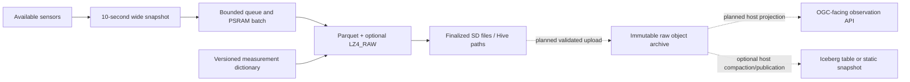
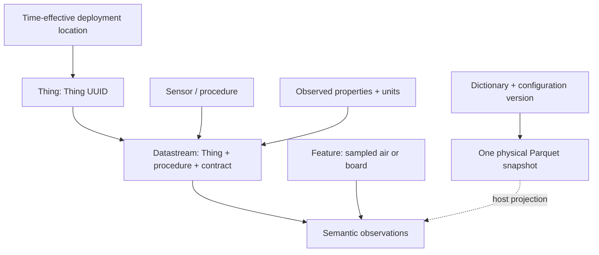

# Table publication and observation semantics


> **Board scope:** Both native ESP-IDF 6.1 logger adapters consume these shared
> observation/archive semantics. CoreS3 and the Waveshare V2 PMS5003T logger each
> write their own schema, named by `kSchemaName` in the board's
> `telemetry_contract.h`. Board acquisition and schema
> identities remain distinct. Native build/host gates pass; dated physical
> evidence below remains scoped to historical Arduino images.

[Router](../README.md) · Design/source review **2026-09-08**. This note is not an Iceberg or SensorThings hardware benchmark. The [telemetry pipeline](telemetry-pipeline.md) owns acquisition, SD durability and upload; the [bench record](../boards/m5stack-cores3/bench-verified.md) owns measured claims.

## Decision: complementary layers

Keep compressed Parquet with Thing/date Hive paths as the device's immutable raw archive. Use a versioned measurement dictionary to describe its meaning. Add an OGC-facing adapter or Iceberg table on the host/cloud when a concrete consumer needs it. Neither requires replacing the device's wide numeric snapshot with JSON observations or moving Parquet generation off the device.



Solid arrows describe the device design; dashed arrows are unimplemented downstream work. The dictionary is the firmware change tracked by this note, not part of the earlier benchmark image. The RAM batch is not power-loss recoverable.

| Layer | Responsibility | Decision |
| --- | --- | --- |
| Parquet + LZ4_RAW | Typed measurements, nulls and page compression | Device implementation exists; dated tests apply only to their image/schema |
| Hive directory layout | Human-readable Thing/UTC grouping and query partition discovery | Preserve current SD/object-key contract |
| Measurement dictionary | Property identity, units, procedure, quality and time semantics | Implement a versioned firmware/host contract |
| SensorThings adapter | Expose observations and linked metadata through a conforming API | Later host/service work, not current compliance |
| Iceberg | Table membership, snapshots and coordinated metadata commits | Later host/cloud experiment |

## Deployment cell and country (native schemas)

The four nullable H3 leaves below arrived in CoreS3 schema v4 (dictionary v3)
and Waveshare schema v3 (dictionary v3), appended after the former 77 and 52
field prefixes. The current schema name, dictionary version and total field
count of each board are not repeated here, because they move with every dictionary bump. Read
`kSchemaName`, `kDictionaryVersion` and the `static_assert` on `field_count` in
`firmware/esp-idf-cores3/bringup/telemetry_contract.h` and
`firmware/esp-idf-waveshare-sim7670g/logger/telemetry_contract.h`, with the
field order in each board's `telemetry_fields.inc`.
Parquet `field_id` exists only from CoreS3 schema v5 and Waveshare schema v4
(commit `e166978`), so older files carry none. Field counts per released
dictionary digest are planned to live in the generated board templates under
`docs/shared/templates` (#85, #86), which do not exist yet.

| Field | Physical type | Meaning |
| --- | --- | --- |
| `h3_cell_id` | INT64 | Official H3 published cell ID, safely within signed range, hex in config |
| `h3_resolution` | INT32 | Actual published cell resolution, potentially coarser than the configured maximum |
| `location_source` | INT32 with `INTEGER(8,false)` (UINT8) | Where the row location came from. 0 none, 1 configured, 2 gnss, 3 phone. Classes live in `telemetry_classes.inc` |
| `geometry` | BYTE_ARRAY with the Parquet `GEOMETRY` logical type, no crs (OGC:CRS84) | 2D WKB Point, little endian, 21 bytes, at the H3 cell centre |

All four are null while the deployment cell is unset, and `geometry` is null
exactly when `h3_cell_id` is null. Since the Thing release (#83) the centre is
no longer two integer columns (decision 32). Each `geometry` chunk carries
Parquet `GeospatialStatistics` (bbox and geometry type) and no min or max. A
second footer key, `geo`, holds compact GeoParquet 2.0 JSON naming `geometry`
as the primary column, with a bbox only when the file has a location. Firmware
derives the centre from the published cell, no raw GPS is stored. The
`opensensor` footer key carries no location (#88). Country is not written to
the file and is not inferred from H3. Today every located row has
`location_source` 1, because the firmware has no GNSS or phone path yet.

Acquisition snapshots cell, maximum precision and country into each queued row.
The worker splits the RAM batch and open file before appending a different
snapshot, including country-only/cap-only changes, so each file holds one
location snapshot. Old finalized files retain their original content and
identity. Changing location does not rewrite earlier samples or archives.
The mobile app requests an OS location fix only on an explicit action, computes
H3 locally at selected precision, previews its derived center and sends only
the cell through authenticated SET_CONFIG. See [time and location](time-and-location.md).

## Static Iceberg is feasible, not a simpler compression format

PyIceberg `StaticTable` reads a table directly from a metadata location without a running catalog lookup, but does not write it. A publisher must still construct valid metadata and provide a discoverable snapshot. Iceberg's metadata JSON, snapshot manifest list and manifests identify the data files; placing Parquet in a directory does not commit it to the table. Updating a shared table needs safe commit coordination. [StaticTable](https://py.iceberg.apache.org/api/#static-table), [Iceberg specification](https://iceberg.apache.org/spec/)

Device-side metadata generation is conceivable but untested here; it is not rejected as impossible. A host-generated static snapshot is the first useful trial if reproducible dataset publication is needed. A managed cloud table becomes worthwhile for coordinated writers, corrections, snapshot-based queries or schema/partition evolution. Iceberg adds table semantics, not another compression layer, and does not automatically combine small data files.

At uninterrupted 15-minute rotation, one Thing creates 96 files/day or 35,040/year; 100 Things create 3,504,000/year, before extra splits (firmware v6 can cut this to 24 files/day per Thing with 60-minute files of four row groups). File discovery and small-file requests may eventually matter more than byte capacity. Measure query latency/request cost before selecting compaction cadence or table infrastructure.

Since CoreS3 v6.12 / Waveshare v2.6 (CoreS3 schema v5, Waveshare schema v4) every leaf carries a Parquet `field_id` equal to its 1-based position in the board's `telemetry_fields.inc`, and the UTC fields are `event_time_utc_us`/`clock_anchor_utc_us` annotated `TIMESTAMP(MICROS, isAdjustedToUTC=true)`, which Apache Iceberg maps to `timestamptz` in format v1, v2 and v3 (NANOS would map only to v3 `timestamptz_ns`). Tables are created as Iceberg v3 on the phone or host. The Thing release (#83) is a fresh field table baseline on both boards, which dropped the H3 centre columns and gave CoreS3 ids 80 and 81 and Waveshare ids 55 and 56 new meanings (owner answer to bridge question 36, 2026-10-26). From that baseline field ids are append only. A dictionary may add fields at the end, but never reorder, remove or reuse a position. Readers never key on an id from an earlier dictionary. Files before v6.12 carry no field ids. Since schema v3 (firmware v6, 2026-09-17) every column chunk carries `min_value`/`max_value`/`null_count` statistics; files written by v1–v5 firmware have `null_count` only and bare INT64 nanoseconds. The Thing UUID is in the path and file metadata, not a row column. PyIceberg 0.12 cannot write v3 tables yet, so register files with iceberg-go 0.7.0 `AddFiles` or iceberg-rust 0.9.0 or later. PyIceberg can import some existing files into v2 tables through name mapping, but its partition inference depends on source-column statistics, which older files lack. Do not assume Hive directories automatically populate Iceberg columns. Test compatibility explicitly; host compaction can materialize Thing identity and typed timestamps in a separate curated table. Do not give Iceberg maintenance ownership of the only raw archive copy: imported files can become eligible for deletion by maintenance. [Existing-file import](https://py.iceberg.apache.org/api/#add-files)

`firmware/common/src/parquet_reader.h` decodes a footer into a caller-owned summary and derives the per-column numbers an Iceberg v3 `DataFile` entry (the same fields as v2) needs. Those are record count, file size, split offsets (row group starts), and per field id the column size, value, null and NaN counts and little-endian lower and upper bounds. It uses no heap and keeps every stack frame under 1 KB. Statistics the footer does not carry are reported as absent, never as zero. Bounds are omitted unless every chunk that holds a non-NaN value has them, and zero float bounds are widened to cover both `-0.0` and `+0.0`. Files without field ids are refused for metrics, so name mapping stays a host decision. Manifests, manifest lists and catalog commits are not written by this code. Today it is host verified only (`pixi run reader-test`, which cross-checks PyArrow and DuckDB, runs crafted hostile footers and a fuzz loop under ASan and UBSan). It is compiled into the firmware component but no board calls it yet.

## SensorThings version and useful concepts

The user's V2.0 slide includes multiple ObservedProperties per Datastream, structured `resultType`, optional `resultEncoding`, and Feature/FeatureType with proximate/ultimate feature relationships. The older [linked overview](https://ogc-iot.github.io/ogc-iot-api/datamodel.html) is not a V2 specification. On this review date, the checked [V2 document 23-019](https://hylkevds.github.io/23-019/23-019.html) explicitly labels itself a draft; the [official standards listing](https://www.ogc.org/standards/sensorthings/) lists published Sensing 1.1. Pin a reviewed revision before implementing an API; do not advertise V2 compliance from a metadata dictionary.

Our proposed mapping:

| Concept | Project interpretation |
| --- | --- |
| Thing | Persistent Thing UUID, footer `thing.id` and Hive `thing=`. Hardware MAC remains separate |
| Sensor | Instrument/procedure, with actual replacement and calibration history when known |
| Datastream | Stable measurement contract for a sensor/procedure on a Thing |
| ObservedProperty | Exact quantity and processing variant; atmospheric PM2.5 is distinct from CF=1 PM2.5 |
| Observation | Sensor result with time, quality and stable identity |
| Location / HistoricalLocation | Deployment geometry and when it applied; unknown until provisioned |
| Feature of interest | What was observed: local air for PM, board for power health; not automatically the Thing location |

One physical Parquet row can supply several semantic observations. Keep the wide row efficient on SD, and project per-instrument results on the host. Group PMS fields into a structured particle result; IMU and power results retain separate provenance. Device health counters are not ambient environmental observations. A driver/procedure identifier is not a sensor serial number or evidence that an optional accessory was attached.



This is our proposed mapping, not a normative UML/cardinality diagram. In the V2 draft a datastream can describe multiple observed properties; do not infer one sensor or one phenomenon time for every column of our heterogeneous physical row.

## First firmware improvement: bounded provenance and time contract

Implementation scope for this revision:

- A single field dictionary drives column names/types and records procedure group, property URI, unit and validity rule. The property URI comes from the board's `telemetry_semantics.inc`, whose header gives the board neutral rule (a NERC term where one matches exactly, else a `urn:walkthru-earth:property:` quantity). The URNs are local vocabulary identifiers, not claims of an OGC-controlled vocabulary or hosted resolver.
- Files reference the dictionary by version, source URI and SHA-256, and include a versioned acquisition configuration. Descriptions are not repeated in every row or as a large JSON object in every tiny file.
- Deployment and calibration identifiers remain explicitly unknown. Owner-declared sensor identity and H3 location can now be provisioned; centers are derived from the retained cell. External deployment history and calibration certification remain future work. Hardware presence and physical coordinates are not invented.
- Append timing columns with a new schema version: snapshot collection completion, most recent valid PMS frame receipt on the device monotonic clock, and the UTC/monotonic anchor used for each row. Unknown anchors and absent PMS frames remain null.
- Snapshot start is not simultaneous physical acquisition across all instruments. PMS receipt is host-side frame availability, not the sensor's internal phenomenon time. Upload/ingestion time must be assigned separately by ingestion, never substituted for measurement time.
- Preserve 10-second monotonic deadlines, validity/nulls, 600/900/1800/3600-second rotation (one 90-row row group per completed batch), runtime codec selection, one filesystem owner and immutable finalized files. No new radios, catalog client or OGC HTTP server.

Validate the exact dictionary/schema with host fixtures in both codecs and both readers, check bounded metadata and null/clock behavior, and build the pinned firmware. New file sizes/timings need new board measurements; the previous 73-column compression ratios and offline-capacity arithmetic remain historical baselines, not predictions for an expanded schema. Hardware flashing and readback must be recorded separately from compilation.

### Source implementation and usage

Firmware `arduino-cores3-parquet-v3` through `-v5` identify themselves as schema `cores3-telemetry-v2` (numeric row value 2), with **77 columns**; the first 73 names/types/order are retained and four nullable INT64 columns are appended. Firmware `-v6` (2026-09-17) writes schema `cores3-telemetry-v3` (row value 3) with the **same 77 leaves and the same dictionary** (`dictionary_version` stays `cores3-telemetry-v2`): the change is file-level — TIMESTAMP annotations on `event_time_utc_ns`/`clock_anchor_utc_ns`, per-chunk statistics, several row groups per file, `created_by` with the build. The schema is not SensorThings version 2: these are independent version namespaces. No existing SD file is rewritten.

Each board has a single-source field dictionary that drives the enum and physical column descriptors in its contract, and the SHA-256 of the dictionary's exact source bytes lives in a digest header. CoreS3 uses [telemetry_fields.inc](../../firmware/esp-idf-cores3/bringup/telemetry_fields.inc), [telemetry_contract.h](../../firmware/esp-idf-cores3/bringup/telemetry_contract.h) and [telemetry_dictionary_digest.h](../../firmware/esp-idf-cores3/bringup/telemetry_dictionary_digest.h). Waveshare uses [telemetry_fields.inc](../../firmware/esp-idf-waveshare-sim7670g/logger/telemetry_fields.inc), [telemetry_contract.h](../../firmware/esp-idf-waveshare-sim7670g/logger/telemetry_contract.h) and [telemetry_dictionary_digest.h](../../firmware/esp-idf-waveshare-sim7670g/logger/telemetry_dictionary_digest.h). On both boards the build and host test reject a stale digest. The source URI names a full commit (#89), and readers still verify the digest rather than trusting the URL alone. The digest covers the `.inc` dictionary, not the entire firmware or all driver behavior. Since CoreS3 v6.13 and Waveshare v2.7 each `FIELD` row also carries its LIVE key, so the digest covers the LIVE key map too. The hash is over raw bytes, so any edit to the file, comments, whitespace and line endings included, moves it. `.gitattributes` pins the file to LF.

Each board also embeds one stac-opensensor v0.1.0 board template, a minified JSON built on the host from the field dictionary, `telemetry_semantics.inc`, `telemetry_classes.inc` and the title and keywords in `telemetry_contract.h`. It sits in `.rodata` as `kTemplateJson` in `telemetry_template.h`, and `desc` in `telemetry_descriptor_digest.h` is the SHA-256 of exactly those bytes. The contract tests fail when either header is stale and validate the template against the pinned schemas. `tools/build-idf-board.sh` checks `desc` before the build and checks the app image holds the same bytes after it. The template's `describedby` link is `kDictionaryUri`, the raw `telemetry_fields.inc` at a full 40 hex commit on `main`, with `file:checksum` `1220` plus the dict digest. The footer `dictionary.uri` inside the `opensensor` key is the same string. `kTemplateHref` names the published template, the raw `docs/shared/templates/<board>/<dict>.json` at a full commit whose bytes hash to `desc` (#89). The footer `template.href` carries it (#88). Commit URLs never move, so the bytes at each link always hash to its digest. `pixi run pinned-uris-test` fails on a `main` or branch URL, on a commit that is not on `main` and on a commit whose bytes miss the digest. Readers trust `dictionary.sha256` and `template.sha256`, never a URL, and fetch the dictionary by its digest. Files written before #88 and #89 carry the old flat `dictionary_uri` (on `main`, which may have moved since) and `dictionary_sha256` keys. That is history only, the app does not read those older files (no backward compatibility, owner decision 14).

Each new file carries exactly one Parquet key-value entry, `opensensor`, whose value is compact JSON per stac-opensensor `footer.json` v0.1.0 at commit `4408c4e52366bb3d154d22bbfffc88ff09aed6f1` (pinned in `tools/stac_opensensor/`). A second key, `geo`, holds the GeoParquet 2.0 metadata for the `geometry` column, and no other key is written. Its groups are `thing` (id, device id, board slug, deployment id and `mobility`), `firmware` (with the 32 hex `boot_id` of the file name), `dictionary` (`sha256` is `dict`), `template` (`href` and `sha256`, which is `desc`), `acquisition` (sample period, time semantics, config id, config and calibration id) and `file` (rotation, row groups, rows per group, compression and purpose). The acquisition configuration describes selected settings, not a complete hardware register dump or proof of a successful sensor initialization. Runtime rotation and compression are recorded separately. Metadata `unknown` is an explicit sentinel, not an actual deployment/calibration identifier. Host adapters must translate it to missing context, not join all unknown deployments together.

```sh
pixi run telemetry-contract-test --sanitize
# Optional JSON export; parent must exist, destination must not already exist.
pixi run telemetry-contract-test --dictionary-out firmware/esp-idf-cores3/artifacts/<dictionary_version>.json
pixi run waveshare-contract-test --dictionary-out firmware/esp-idf-waveshare-sim7670g/artifacts/<dictionary_version>.json
# Read the connected firmware's actual schema; does not reset or flush.
pixi run parquet-device command --port <checked-port> 'parquet schema'
```

`parquet schema` emits a BEGIN line (schema, columns, the dictionary `sha256`, the board template `desc` and its `desc_bytes`), one FIELD line per leaf of the running schema and END; it is a bounded diagnostic, not a SensorThings endpoint. Physical type codes match the writer: 1 = INT32, 2 = INT64, 4 = FLOAT. Property URIs include the exact column name, so CF=1/atmospheric PM and raw/physical quantities cannot be silently conflated. Procedure IDs describe logical code paths; append Thing/deployment/instrument identity in the later service mapping.

### Timing and validity dictionary

```mermaid
sequenceDiagram
    participant P as PMS UART parser
    participant L as Logger loop
    participant W as Storage worker
    participant C as Future cloud ingestion
    P->>P: Checksum-valid frame received; save monotonic receipt
    L->>L: 10-second deadline; snapshot start and clock anchor
    L->>L: Read available instruments sequentially
    L->>L: Record collection completion
    L->>W: Queue immutable row
    W->>W: Rotate batch; finalize Parquet on SD
    Note over W,C: Upload not implemented; delay can include offline days
    W-->>C: Future upload of finalized bytes
    C->>C: Assign ingestion time separately
```

The clock anchor pair in each row supports auditing the UTC mapping without relying on a later mutable global anchor. It does not fix host truncation, transport delay, oscillator drift or unknown sensor integration time. The receipt timestamp identifies even a stale/error-bearing checksum-valid PMS frame, while its measurement values remain governed by `pms_status`. Collection completion is not a physical phenomenon time or sensor result time. Clock corrections larger than two seconds, initial UTC and RTC-to-external upgrades split files using the clock-epoch mechanism; small host/network refreshes retain their epoch with exact new anchors captured per future row. Unsynced rows remain unsynced.

| Validity token | Meaning in this implementation |
| --- | --- |
| `always` | Populated logger/API status or counter; presence does not establish physical accuracy |
| `clock_anchored` | An anchor exists for this row's clock epoch (host-supplied this boot, `clock_status = 1`; RTC-restored from an earlier external sync, `clock_status = 2`; or successful Wi-Fi SNTP on this boot, `clock_status = 3`); otherwise null |
| `pms_present` | At least one checksum-valid frame received this boot, including stale/error-bearing frames |
| `pms_valid` | `pms_status=4`: present, beyond boot warm-up, within stale threshold, sensor error zero |
| `accel_fresh_finite`, `gyro_fresh_finite` | Corresponding M5 IMU fresh bit and finite value |
| `mag_fresh` | Corresponding fresh bit; uncalibrated auxiliary raw counts |
| `imu_temperature_read_finite` | Enabled IMU, successful temperature read and finite value; die, not ambient temperature |
| `light_valid`, `proximity_valid` | LTR driver validity booleans after fresh read and channel checks; status also reports shared I/O errors |
| `api_report_unqualified` | M5 API report; not independent proof of battery presence, power flow or accuracy |
| `battery_range_0_100` | API result within 0–100; battery presence remains unqualified |
| `rtc_read_ok` | Successful RTC API read of the BM8563 calendar as a diagnostic column (`rtc_date_yyyymmdd`, `rtc_time_hhmmss`, UTC). The row's `event_time_utc_us` never comes from this read; the RTC feeds the clock only through the boot-time seed recorded as `clock_status = 2` |
| `touch_present` | Nonzero touch count; first reported point |
| `sd_mounted_cached` | Startup mount succeeded; size values are cached KiB-resolution reports, not hotplug proof |
| `unavailable` | Intentionally null: unsupported battery current or unresolved SHT20 isolation |
| `battery_installed` | Waveshare v5. The image declares an installed battery. `battery_health_state` is then always written, with code 0 when no valid cell voltage has been classified yet |
| `battery_installed_vcell_read_ok` | Waveshare. Battery declared and the MAX17048 VCELL word read and passed its range check, for `battery_mv`. A good VCELL is published even when SOC failed, with `gauge_status=1` and a null percent |
| `battery_installed_soc_read_ok_range_0_100` | Waveshare. Battery declared and the MAX17048 SOC word read and passed its range check, capped to 0 to 100, for `battery_percent` |
| `battery_installed_soc_read_ok_uncapped` | Waveshare v5. Battery declared and the MAX17048 SOC read passed its range check, independent of VCELL. The raw percentage is not capped and can exceed 100 on external power |
| `battery_installed_crate_read_ok`, `battery_installed_status_read_ok`, `battery_installed_mode_read_ok` | Waveshare v5. Battery declared and the matching MAX17048 CRATE, STATUS or MODE register read succeeded. Each register read is independent |
| `battery_soc_trusted_discharging_within_7_days` | Waveshare v5. SOC read is valid, at most 100%, not settling after a gauge reset, CRATE is negative and the estimate is at most 10080 minutes. A planning estimate, not a measured runtime |

The `unit` strings are project labels, not a claim of universal UCUM validity. In particular `g` means standard-gravity multiples here, `deg/s` angular velocity, `count/0.1L` cumulative particle counts per 0.1 litre, and `raw_count` is not lux, distance or magnetic field. Codes/bitmasks/calendar encodings require their documented interpretation.

### Validation status

The current 90-row CoreS3 and Waveshare synthetic contract fixtures, one column per `telemetry_fields.inc` row, pass PyArrow and DuckDB in both UNCOMPRESSED and LZ4_RAW, with anchored and unsynchronized clocks, under ASan/UBSan. Tests cover the compiled dictionary digest, numeric types/order, the retained TIMESTAMP types and current `created_by`, `sequence`/UTC/all-null statistics and the `sequence` sort declaration, missing measurements, anchor values, completion/receipt timestamps, immutable earlier rows across a clock correction, explicit unknown context, nullable/coarsened H3 centers and country metadata. These tests exercise the shared contract/writer, not real sensor collection or storage-worker scheduling. The generic writer suite remains separate.

The revision was then flashed with hash verification on **2026-09-08**. Real SD readbacks passed for three unsynchronized UNCOMPRESSED rows and four host-anchored LZ4 rows. Column/dictionary metadata, null anchors before synchronization, exact UTC mapping after synchronization, receipt/start/completion order and zero stored health errors were checked. `parquet schema` completed on the board. The logger was left at 15-minute rotation with LZ4 and host UTC restored. These are smoke tests, not full-window endurance, calibrated time accuracy or SensorThings/Iceberg compliance. [Artifact identities, timings and measured scope](../boards/m5stack-cores3/bench-verified.md#board-1-schema-v2-provenance-and-timing)
