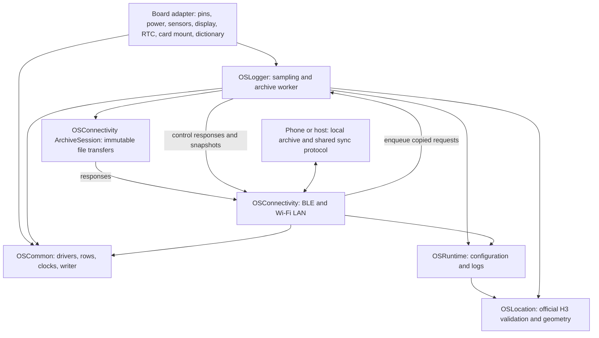

# Reusable firmware modules

The common tree contains seven opt-in native ESP-IDF components, **OSCommon**,
**OSSensors**, **OSRuntime**, **OSConnectivity**, **OSLogger**, **OSLocation** and `power`. The target is ESP32-S3 with
ESP-IDF 6.1; application source uses no Arduino APIs. Pure framing, encoding and
math plus the actual status/provisioning helpers remain host-testable. Boards
own peripheral initialization and consume only the required components.

| Module | Shared responsibility | Consumer supplies |
| --- | --- | --- |
| `sensors/src/pms_frame.*` | Plantower byte framing, checksum, model-specific decoding | UART, selected sensor model, freshness/warm-up policy |
| `sensors/src/aq_ltr553.h` | LTR553 register setup and raw validity | Existing bus read/write and timing callbacks |
| `sensors/src/aq_max17048.h` | MAX17048 VCELL/SOC and diagnostic register reads, decoding, range checks and a verified reset-indicator clear | Existing bus read callback, optional write callback, battery-installed policy |
| `power/src/aq_battery_health.*` | Pure battery state classifier with debounce, hysteresis and post-reset settling | Validated thresholds, monotonic time, gauge samples and any load shedding |
| `src/numeric_sample.h` | Fixed-size numeric rows with explicit validity/nulls | Board field dictionary and collection |
| `src/utc_clock.h` | UTC anchor arithmetic, source codes, calendar conversion and supported bounds | Coherent anchor locking, host sync and optional RTC adapter |
| `src/parquet_writer.*`, `lz4_codec.*` | Bounded Parquet encoding and pinned LZ4 | Columns, provenance, memory, file sink and rotation policy |
| `src/sync_codec.h` | Little-endian frames, CRC32, safe relative names, structural file completion | Checked buffers, mount roots and reader conformance checks |
| `runtime/src/device_config.*` | NVS pairing/Wi-Fi/LAN/NTP/H3 settings, tokens and paged CONFIG JSON | First-boot display capability; command execution and owner access to pairing PIN |
| `runtime/src/debug_log.*` | Bounded diagnostic ring and console forwarding | Optional console function/context sink, configured before tasks start |
| `connectivity/src/ble_sync.*` | Secure GATT pairing, advertising, framing and notifications | Stable identity, nonblocking request-queue handler, status/live snapshots |
| `connectivity/src/wifi_link.*` | Wi-Fi station/provisioning, scans, mDNS, token-authenticated TCP | Stable identity, same request handler and configuration |
| `connectivity/src/network_time.*` | Router DHCP42, configured local NTP, permitted public fallback, age/provenance and bounded anchor handoff | One network owner drives lease/reconnect/poll; deployment-approved policy |
| `location/src/aq_location.*` | Official H3 validation, parent coarsening, grid centers and assigned country-code validation | Explicit owner-provisioned cell/privacy cap; no retained GPS or inferred country |
| `connectivity/src/control_sync.*` | Configuration, BLE-only token and bounded log-tail commands | Worker-side response adapters |
| `connectivity/src/sync_service.*` | Configuration and transport startup | Storage queue ready, identity and display capability |
| `connectivity/src/archive_sync.*` | Immutable file LIST/OPEN/READ/CLOSE sessions, offsets and link generations | Archive enumeration/path/finalization callbacks, worker bus lock and response adapters |
| `logger/src/os_logger.*` | Sampling deadline (`Config::sample_interval_ms`, 10 s default), single worker, Thing identity, clock anchors, PSRAM batching, Hive paths, immutable archive lifecycle and serial/link snapshots | Static board dictionary/provenance, acquisition callback, already mounted filesystem, capacity and optional bus/RTC callbacks |
| `logger/src/os_logger_status.*` | Pure bounded STATUS formatting | Coherent runtime snapshot |
| `logger/src/os_logger_provision.*` | Physical UART profile encoding and local SET_CONFIG reply capture | Physical serial owner access; host handling that excludes credentials from captures |



## Shared caps a new board must check

These limits are shared by every board. A new board checks each one against
its own dictionary and cadence before it ships, and raises a cap only in its
own PR with the reason and both board builds green.

| Cap | Where | What it bounds | What a new board must check |
| --- | --- | --- | --- |
| `kMaxColumns = 96` | `src/parquet_writer.h` | Columns per file, including the four required runtime fields. Sizes the PSRAM writer workspace (`kMaxRowGroups` x 96 chunk records) and the `Row` type | `begin()` refuses a dictionary over 96 fields. Count every column, including runtime counters, and leave room for appended fields, since positions are never reused |
| `cadence::kMaxBatchRows = 90` | `logger/src/os_logger_cadence.h` | Rows in one RAM batch, which is one row group and the loss window on reset. Footer `file.row_group_rows_max` | Rows per group are the rotation window divided by `Config::sample_interval_ms`, at most 90. A file holds at most `kMaxRowGroups = 8` groups (720 rows), so a fast period with a long window closes several files per window. The period must pass `cadence::valid_sample_interval()`, 1 s to 300 s and a divisor of 300 s |
| 480 byte STATUS and LIVE JSON | `ble::kMaxJson` in `connectivity/src/ble_sync.h` | Each snapshot, so one BLE frame (512) and MTU 483 carry it | Add up every `live_key` of the board at its widest value. A LIVE document that does not fit is not published at all, never truncated. Prove the worst case with a host test like `logger-live-test` |
| `footer::kMaxJsonBytes = 4096` | `logger/src/os_logger_footer.h` | The one `opensensor` footer value, compact JSON per stac-opensensor `footer.json` v0.1.0 | The board strings (`acquisition.config` above all) must keep the JSON under 4096 bytes. A footer that does not fit fails the file closed with `footer-overflow`, never truncated. CoreS3 writes 1663 bytes and Waveshare 2287. The contract tests print the length |
| BLE name at most 11 characters | `ble::wire::kMaxLocalName` in `connectivity/src/ble_advert.h` | Prefix plus four device id characters, so the full service UUID fits the legacy scan response | `Config::ble_name_prefix` is 1 to 7 characters of `[A-Za-z0-9-]`. Required, with no default in `firmware/common`. The mDNS host is the name in lower case. CoreS3 and Waveshare pass `OS-` (`OS-xxxx`, `os-xxxx`). The current app filters its scan with `AQ-`, so it must scan by the GATT service UUID or learn each new prefix, see [mobile-migration.md](../../docs/shared/mobile-migration.md) |

Both boards keep the default values. Footer `acquisition.sample_interval_ms`
comes from the live `Config::sample_interval_ms` (default `10000`), the same
value that sets the sampling deadline, so it is the truth for each file.
`file.row_group_rows_max` comes from `cadence::kMaxBatchRows` (`90`), and
`thing.deployment_id` and `acquisition.calibration_id` from `Config`
(default `unknown`). `acquisition.sample_interval_ms` and
`file.row_group_rows_max` are JSON numbers, and `thing.deployment_id` and
`acquisition.calibration_id` are JSON strings, `"unknown"` included, all inside
the one `opensensor` footer value. The build time `opensensor:sample_interval_s` in
the board template is only the default. Readers trust the footer. `pixi run logger-footer-test` pins the default bytes and writes a non
air quality fixture board with no PMS, a 30 s period and an `SL-` prefix.

## Consumption

Board projects list the common paths in `EXTRA_COMPONENT_DIRS`; their component
`CMakeLists.txt` declares `REQUIRES common sensors runtime connectivity logger`
for a logger or `common sensors runtime` for the retained Waveshare
diagnostic, whose Plantower parser now lives in `sensors`. Use the root Pixi
build tasks rather than Arduino CLI:

```sh
pixi run idf-setup
pixi run cores3-build
pixi run waveshare-build
pixi run waveshare-build diagnostic
```

OSRuntime replaces Preferences with native NVS while preserving namespaces,
keys and value types, including Thing identity. DebugLog uses `LogOutput`
and the native physical console. OSConnectivity uses native NimBLE GATT/GAP,
Wi-Fi events and `esp_netif_sntp`, plus managed mDNS 1.14.0. Driver credential
storage is RAM only; `oscfg` remains the sole persistent settings owner. The
logger keeps only its `thing` and `codec` keys in the `parquet` namespace.
Existing Arduino-era BLE bonds need hardware qualification and may require
phone re-pairing. This does not authorize erasing identity or settings.

Call `oslogger::begin(config, hooks, sd_mounted)` once after board setup, then
`start_links(display_detected)` and `poll()` on the main loop. Stable descriptors
and callback contexts must outlive the runtime. The board collector fills only
hardware fields; the engine maps standard clock/identity/counter fields by name,
sets matching types only, and leaves absent or unavailable measurements null.
Capacity callbacks borrow the board's mounted filesystem. Bus callbacks are a
pair; otherwise the engine owns its mutex. RTC callbacks run only on the main
task, including writes requested by worker-side host synchronization.

BLE and LAN copy requests into the worker queue without touching the card or
display. Startup enumeration emits a bounded count/partial summary rather than dumping
archive paths to USB; explicit `parquet list` retains its full serial protocol.
The worker owns filesystem access after startup, rotation, row-group
sync, finalization and preserved-partial quarantine. It invokes the shared
ArchiveSession and common configuration handlers. No mount, format, retention
delete or cloud upload is introduced. The card remains the data origin and the
phone/laptop archive its first copy. Finalized files are immutable; each completed
row group is fsynced, but unfinished RAM rows can be lost and power-cut durability
requires board measurements.

Both current board logger adapters consume OSLogger. CoreS3 retains M5Unified,
its 81-column `cores3-telemetry-v6` schema with dictionary v7, SPI/display arbitration and optional BM8563 hooks.
Waveshare supplies its 62-column PMS5003T `waveshare-sim7670g-telemetry-v6` schema with dictionary v7 and one-bit SDMMC adapter,
with no RTC hook in this image. Its retained diagnostic consumes common/runtime for the parser and physical
console, without starting the logger or radio services. Source integration does not transfer hardware measurements between
boards; use each board's bench record for the deployed image and tested scope.

STATUS/LIVE JSON allows 480 bytes while BLE frames remain capped at 512. MTU 483
can carry the largest JSON value in one notification. Publishers always cache
the complete value and omit notifications exceeding negotiated MTU − 3; clients
use characteristic long reads for complete cached snapshots. The host STATUS
boundary test retains every key at 476 bytes even with the widest numeric values.
LIVE keys come from the `live_key` each board sets in its field table. `t` and
`rh` are ambient only, and CoreS3 IMU temperature is `imu_t`. A declared key with no reading is null.
Floats print with the decimals each board sets per field. Without an RTC,
`rtc=2`, `clk=0` and UTC stays null until host SET_TIME or a successful network response, including after reboot.

OSLocation vendors unmodified official H3 4.5.0 with verified hashes. OSRuntime
stores one coherent location record containing only the coarsened cell, cap and
optional owner-declared ISO country. OSLogger captures it at acquisition and
splits batches/files when it changes. Four nullable fields carry the cell,
actual resolution, location source and the cell centre as a WKB Point. Since #88
the `opensensor` footer key carries no location or country. The [time/location contract](../../docs/shared/time-and-location.md)
describes mobile provisioning and NTP restrictions.

Physical serial owner/provisioning commands are documented in [OSLogger](logger/README.md).
Their PIN/profile replies bypass the log ring and radio interfaces; host tooling
must consume credentials in memory and exclude them from retained captures.

Verification commands: `pixi run common-test`, `ltr553-test`, `config-test`,
`control-sync-test`, `location-test`, `network-time-test`, `archive-sync-test`, `pms-frame-test`, `parquet-test --sanitize`,
`telemetry-contract-test --sanitize`, `waveshare-contract-test --sanitize`,
`connectivity-build-test`, `logger-build-test`, `logger-status-test`,
`logger-provision-test`, and affected board builds. Generic compile fixtures
have no M5 dependency and are never flashed. Host fixtures establish logic and
format boundaries, not real radio behavior, NVS atomicity or SD durability.

### Historical Arduino verification on 2026-09-28

The pre-OSLogger gates, formatting, cppcheck and host BLE/LAN protocol tests passed for the historical builds below. The host module tests use AddressSanitizer and UndefinedBehaviorSanitizer; Parquet/measurement fixtures also passed both readers.

| Compiled consumer | Program bytes | Static RAM bytes |
| --- | ---: | ---: |
| CoreS3 source v6.4 | 1,422,279 | 86,036 |
| Generic ESP32-S3 connectivity fixture | 1,082,380 | 63,976 |
| Waveshare diagnostic (base library only) | 353,853 | 22,288 |

The retained Waveshare diagnostic produced the UART/TF observations in its [bench record](../../docs/boards/waveshare-esp32-s3-sim7670g/bench-verified.md). The historical CoreS3 v6.4 build was subsequently flashed and passed a [short hardware test](../../docs/boards/m5stack-cores3/bench-verified.md#board-1-shared-esp32-s3-modules-firmware-v64), including identical BLE/LAN Parquet readback. This does not extend the earlier full-window/endurance measurements to the extracted image.

### Historical OSLogger host/Arduino compile verification on 2026-09-28

The generic ESP32-S3 logger fixture compiled with all four components and no
M5Unified/M5GFX dependency: 1,139,806 program bytes and 83,500 static RAM bytes.
ASan/UBSan checked the actual STATUS formatter (398/393 bytes for the two codecs,
including numeric maxima and truncation boundaries), and actual SET_CONFIG
validators/actions behind UART provisioning (UTF-8 hex round trips, malformed
inputs, command bounds and diagnostic-ring secrecy). These are source/host gates;
board tests and their image identities belong to the board bench records.
