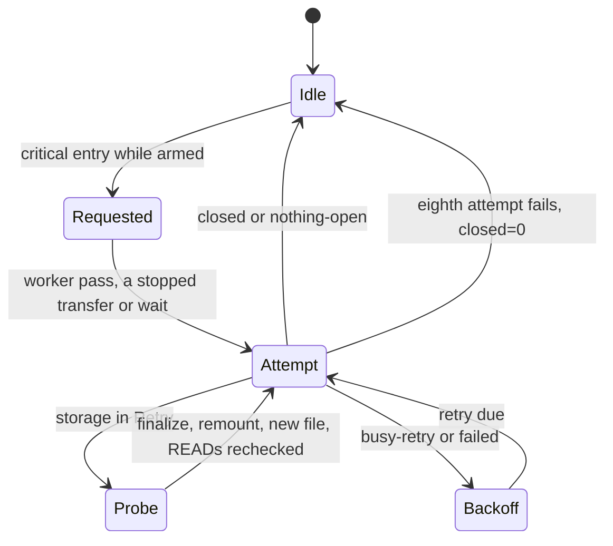

# AQLogger

Opt-in native ESP-IDF logger engine shared by ESP32-S3 board adapters. Add the
common component directories to the board CMake project and declare
`REQUIRES common runtime connectivity logger location`. ESP-IDF and managed dependency
versions are pinned by the shared toolchain lock and component manifests.

## Adapter contract

Include `aq_logger.h`. Define a static `aqlogger::Field[]` dictionary and fill
`Config` with its schema/dictionary identity, digest, acquisition configuration,
board identity and optional board metadata. The runtime requires `sequence`,
`monotonic_us` and `event_time_utc_us` as INT64, and `clock_epoch` as INT32. Other
standard runtime fields are mapped by name and set only when present with the
matching type. Field units `us_since_unix_epoch` receive TIMESTAMP(MICROS, UTC),
which Apache Iceberg maps to `timestamptz` (v1, v2 and v3). Every column gets Parquet
`field_id` = its 1-based position in the dictionary, so dictionaries are append
only. Never reorder, remove or reuse a position.

Call `begin(config, hooks, sd_mounted)` once after board/storage initialization,
then `start_links(display_detected)` and `poll()` on every main-loop pass.
Descriptors and callbacks must remain alive. `poll()` performs at most one sample
when due, counts skipped deadlines and advances the sequence accordingly. The
hardware acquisition callback fills a zero-initialized fixed-capacity `Row`;
unavailable measurements stay null. It can use board enum indices or the engine's
absent/type-safe `integer`, `counter` and `number` helpers.

The board supplies mounted filesystem capacity callbacks. It may supply paired
bus mutex callbacks, or use the engine's `lock_bus`/`unlock_bus` around shared
transactions; complete display DMA before unlocking. No filesystem mounting,
formatting, peripheral or controller initialization happens here. Output defaults
to `/sd/output`; `legacy_directory` is opt-in for previous archives.

Battery health is optional. A board that runs `aq::battery::Monitor` from
`firmware/common/power` calls `report_battery(state, mv)` from its collect
hook. The runtime prints `POWER STATE state=<name> mv=<n>` once per change and,
on a critical entry while armed, appends ` action=finalize` and raises the
emergency close described in Battery emergency close below.
`Hooks::power_shed` is an optional no-op by default, called on the main loop
after each change. Nothing here resets, sleeps or turns off radios.

Optional RTC callbacks run only in `begin()` and `poll()` on the calling main
task. Read returns UTC seconds only after rejecting invalid/unset/voltage-low
state; write must verify readback. With no RTC, state is 2 (unusable/absent), UTC
stays null until a real host or network anchor, and no RTC write occurs. A host sync only
sets an atomic pending request on the worker. The main loop writes near the next
whole-second boundary, with a bounded late fallback.

## Archive and transport behavior

One worker owns the filesystem, and receives copied nonblocking control requests
from BLE/LAN. Card data is the origin: finalized files can be copied over serial,
BLE or token-authenticated local LAN without any cloud service. The runtime uses
the existing protocol UUIDs, settings, station NVS key and archive sessions.
BLE and up to three authenticated LAN clients retain independent file handles;
OPEN, CLOSE and disconnect affect only the requesting connection. Queued stale
commands and responses are rejected by connection generation. Each open handle
keeps one read-only descriptor with a 4 KiB PSRAM stdio buffer from OPEN until
CLOSE, a replacing OPEN, an archive erase, a remount or the first request on any
link after that peer's connection generation changes. A disconnect alone does not
release it. READ windows seek within it. Both board
mounts reserve these four descriptors (`archive_files.h`), and a storage remount
releases them so the next READ reopens by path. OPEN takes the CRC-32 from a
64-entry PSRAM cache filled at finalize (path, size and mtime must match) and
reads the whole file only on a miss. The boot `PARQUET BEGIN` line reports
`crc32_check=ok` when the ROM CRC routine returns the standard check value.
LIVE emits the `Field::live_key` of every valid field, in field-table order,
through `aq_logger_live.h`. `begin()` rejects malformed or duplicate keys.
Absent, invalid and non-finite measurements are omitted independently.

The RAM batch holds at most 90 rows. Each completed row group is fsynced and a
file holds at most eight row groups. Clock epochs and UTC rotation windows never
mix; station location snapshots never mix either. Unknown UTC uses the `unsynced`
Hive tree and rotates on the same window measured on the boot's monotonic clock.
Finalization writes/syncs the
footer, checks structure and CRC, then renames to immutable `.parquet`. Interrupted
`.partial` files are retained under `quarantine/<station>/<partition>/`, at boot
and right after a same-boot failure; a partial whose finalized sibling exists is
left in place as a crosslink suspect. Automated logging and sync never repair,
delete or rewrite owner archives, and never format or upload. The separate
physical serial [archive reset](../../../docs/shared/development.md#owner-maintenance)
requires an explicitly requested destructive reset and is unavailable over radio.

The SD space governor (`src/storage_governor.h`) is pure and header-only. Ready
and degraded write. Full finalizes the open file and raises
`PARQUET ALARM storage=full` below the reserve, normally 32 MiB with smaller-card
scaling. Full and retry stop normal card writes but retain a bounded RAM batch. New
rows drop when that batch is full or a partition/window change cannot be committed.
Retry follows any write, close,
rename or mount failure and probes on a 10 s to 10 min backoff, remounting through
the optional `storage_remount` hook. Boards supply `storage_free_bytes`,
`storage_cluster_bytes` and `storage_remount`; `firmware/common/src/fat_volume.h`
has the FatFs helpers. STATUS carries `sd_state` (0 to 3). RAM batches can be lost on reset;
footerless completed row groups need explicit host recovery. fsync is not proof
of power-cut durability.

The optional [location component](../location/README.md) supplies validated H3
cells and their grid centers. AQLogger snapshots cell, maximum resolution and
optional declared country at acquisition, copies them through the queue and
uses the first row's snapshot for file metadata. Changing any of those settings
closes the previous file before adding new-location rows, including while a RAM
batch is waiting. Four nullable fields are mapped only when the board dictionary
contains all four: `h3_cell_id` (INT64), `h3_resolution` (INT32),
`h3_center_lat_e7` and `h3_center_lon_e7` (INT64, 10⁻⁷ degrees). Raw GPS never
enters the logger. Country and source/precision metadata describe the whole file.
See [time and location](../../../docs/shared/time-and-location.md) for owner policy.

Serial commands remain `parquet status`, `schema`, `list`, `get`, `time`, `flush`,
`interval` (600/900/1800/3600), `codec none`, `codec lz4`, and `codec-test`. Codec
comparison files remain separately labeled duplicate-row benchmark artifacts under
`Config::benchmark_directory` (`/sd/bench`), outside the listed archive. Their 4 KiB
staging buffer is borrowed from PSRAM only while the command runs.

Startup scans archive entries/stats and retained partials on the storage worker,
then emits one bounded `PARQUET SCAN` summary. It does not print every archived
path or `PARQUET LIST END` at boot: an archive-sized USB dump can block sampling
storage until a serial reader drains it. An explicit `parquet list` request
retains full `PARQUET FILE` entries, partial summary and `PARQUET LIST END`.
While a BLE or LAN `LIST` runs, `parquet list` answers
`PARQUET ERROR operation=list reason=busy-list` instead, because the card
reserves directory handles for one walk only. Run it again once the radio
`LIST` ends. `parquet get` reads one file and is not refused.
No filesystem ownership, retention or sampling-clock policy changes with this
output choice.

`parquet owner-pin` is a physical serial-only owner command for a headless
fixed-PIN device. It emits `AQ OWNER_PIN` directly to the physical console, bypassing the
shared debug ring and BLE/LAN LOG_TAIL. Random pairing mode instead asks the
owner to use the pairing display. There is no corresponding radio opcode,
CONFIG secret field, or boot PIN print. Host tooling must consume/redact the
response rather than save it in captures or repository artifacts.

The physical serial `parquet wifi-profile` command exports only SSID/PSK bytes
as hex plus Wi-Fi/LAN enable flags in one raw `AQ WIFI_PROFILE` line. It bypasses
DebugLog and has no network opcode. `parquet config-hex <hex>` imports up to 511
bytes of whole `key=value` lines through the real shared SET_CONFIG handler:
existing validation, NVS persistence, bond clearing, token-session dropping and
Wi-Fi reconfiguration all keep their established behavior. Its reply is a
secret-free `AQ CONFIG ok=1 reboot_required=<0/1>` acknowledgement. Errors expose
only allowlisted key identifiers. Embedded NULs, invalid hex, oversize input and
invalid settings are rejected. Hosts must handle credential output in memory and
exclude it from captures and artifacts.

## Battery emergency close

A critical battery asks the storage worker to finish the open Parquet file
so the rows already buffered survive a brownout. The pure parts live in
`aq_logger_power.h` (when to ask and the main loop report),
`aq_logger_emergency_close.h` (the intent, outcomes, retry, the worker pass
and its log line) and `aq_logger_transfer_gate.h` (how a due close stops a
transfer). `pixi run logger-power-test` covers the first two, and
`archive-sync-test` and `wifi-link-test` drive the gate through the real
archive session and LAN transport.

- One close per discharge. After a critical entry asks for a close, nothing
  re-arms it until the battery recovers to ok, which already needs the low
  threshold plus hysteresis, or to external power. A rebound to low, an
  unknown read or a settling gauge does not re-arm it. Settling also covers
  a gauge reset at runtime, so a recovery in that window re-arms only once
  settling ends. A fresh boot starts armed, so a cut before the close asks
  again on the next critical report.
- `report_battery()` on the main loop only raises an atomic intent and wakes
  the worker. It never touches the card and there is no queue to fill.
- The worker checks the intent at the top of every pass, before samples and
  queued commands. A due close also stops a BLE or LAN LIST or READ at its
  next data frame with the existing busy error, and a serial `parquet get`
  between blocks with `PARQUET ERROR operation=get reason=power-critical
  offset=<n>`. A data frame already waiting for ring space stops waiting at
  the next wait step too, so a peer that stopped draining cannot hold the
  close back for the slow peer bound. Terminal frames are never cut short.
  Clients retry after the close.
- With storage in Retry, the attempt's writable check runs the governor
  probe. That probe finalizes the open telemetry file, remounts the card
  and commits the buffered rows to a new file, which the close then
  finishes. The remount reaches the archive session, so every open READ
  handle is rechecked before its next CHUNK and a changed file ends with
  bad handle instead of stale bytes (#41).
- Each attempt reports one outcome, and `files=<f>` counts every telemetry
  file finalized during it, including one the probe closed. `closed` logs
  `PARQUET FLUSH reason=power-critical result=closed attempt=<n> files=<f>`.
  `nothing-open` (no rows buffered, no file open) is quiet on a first
  attempt. After a retry it logs `result=nothing-open attempt=<n> files=<f>`,
  because an earlier probe may have closed the file. `busy-retry` (storage
  not writable) and `failed` (the finalize write failed) log `PARQUET FLUSH
  reason=power-critical result=<outcome> storage=<state> attempt=<n>
  files=<f> retry_ms=<ms>` and back off 1, 2, 4, 8, 16, 30 and 30 s. After
  eight attempts the worker logs `PARQUET ERROR operation=power-close
  reason=<outcome> attempts=8 files=<f> closed=0`, where `closed=0` says the
  close itself never finished, and drops the intent. A finalize that wrote
  but whose free space reading then failed still counts as closed, and the
  governor records the reading failure. Rows still queued go to the next
  file.

The retry bound is not yet tied to measured energy. It moves with the
discharge calibration in issue #28.

## Radio LIST job

A BLE or LAN `LIST` runs as a job of bounded steps on the storage worker
(`archive_sync.h`). The worker glue around it lives in
`aq_logger_list_job.h` as pure decisions that `archive-sync-test` drives with
the real session and storage governor. It covers three things. Periodic
remounts wait for the job, so a full card is measured without a remount and
a card in Retry is probed without one, and the skipped remount runs after the
job. One request from the job's own link and peer waits in a parked slot
outside the command queue, so requests from other links behind it still run.
Serial `parquet list` is refused while the job runs. A due critical battery
close first ends a running job with ERROR busy "preempted"
(`preempt_for_close`), so the close's Retry remount never reaches a live
walk.

## Worker watchdog

The `parquet-sd` worker stamps a heartbeat on every loop pass, at each BLE/LAN
frame, per directory entry in every archive walk (startup scan, partial
quarantine, `parquet list`, each bounded step of a BLE or LAN `LIST`,
ERASE_ARCHIVE preflight and delete), on both sides
of the board free-space, capacity and remount hooks, and once per second while
paused after an erase. The writer stamps only on confirmed progress, after each
block its output sink writes, after each encoded row group and after each
completed fsync. A sink call that never returns therefore still trips the
watchdog, while a slow write that keeps landing blocks does not. Each stamp
also feeds the worker's task watchdog user. A BLE or LAN frame wait stamps
between its steps, so each transport bounds it. BLE gives up after twice
`progress_timeout_ms` and LAN after twice `slow_peer_ms` without progress
(30 s each by default), so a stuck radio task cannot keep a worker that
writes nothing looking alive.

- `begin()` seeds the heartbeat just before it creates the worker task, so a
  worker that blocks before its first stamp ages out like any other stall.
- `poll()` keeps the passive warning. After 5 s without a stamp it logs
  `PARQUET ERROR operation=worker-stall seconds=N state=... stack_free=...
  watchdog=armed|warn|off`, at most every 30 s.
- With `CONFIG_AQ_LOGGER_WORKER_WDT=y` (default) `begin()` registers the worker
  with the ESP-IDF task watchdog through `esp_task_wdt_add_user("parquet-sd")`.
  The task watchdog has one period for all users and the idle tasks
  (`CONFIG_ESP_TASK_WDT_TIMEOUT_S`, 5 s), so a 1 s `esp_timer` supervisor also
  feeds the user on the worker's behalf while the heartbeat is younger than
  `CONFIG_AQ_LOGGER_WORKER_WDT_TIMEOUT_S` (default 60 s). A single SD call
  between two stamps, such as a first FAT free-cluster count or a remount, may
  therefore take up to that timeout without a false reset.
- When the heartbeat is older than the timeout, the supervisor stops feeding,
  marks a pending stall in RTC no-init memory and switches the task watchdog to
  panic. Within one more watchdog period the IDF prints
  `task_wdt: ... - parquet-sd (user)`, panics, saves the core dump (both board
  tables reserve the 64 KiB `coredump` partition and the shared defaults enable
  `CONFIG_ESP_COREDUMP_ENABLE_TO_FLASH`) and resets with reason `TASK_WDT`.
  Idle tasks keep their print-only behavior until a worker stall is declared.
- If the worker stamps again before that period ends, the supervisor recovers.
  It withdraws the pending stall, restores the task watchdog config the IDF
  started with (from `CONFIG_ESP_TASK_WDT_*`, so idle tasks and other users get
  their own panic policy back) and resumes feeding. `poll()` then logs
  `PARQUET WATCHDOG mode=armed consecutive=N reason=recovered`. A later stall
  trips again, and a later task watchdog reset that this firmware did not arm
  is not counted as a worker stall.
- The supervisor never leaves a user armed without a feeder. When the timer
  cannot be created or started, `begin()` deletes the user again and logs
  `mode=warn ... supervised=0`. A refused panic switch withdraws the pending
  stall and retries on the next tick. A refused restore keeps feeding and
  retries until the original config is back.
- The next boot logs `PARQUET ERROR operation=worker-watchdog-reset
  consecutive=N`. Every boot logs one `PARQUET WATCHDOG mode=armed|warn
  timeout_s=... consecutive=... max_consecutive=3 healthy_s=... supervised=1`.
  After three stall resets without a healthy period in between, the worker is
  warn-only: no reset, only the `worker-stall` warnings. A plain reboot does not
  clear the count. `CONFIG_AQ_LOGGER_WORKER_WDT_HEALTHY_S` (default 3600 s) of
  continuous liveness clears it, re-arms a warn-only worker and logs
  `PARQUET WATCHDOG mode=armed consecutive=0 reason=healthy`. Power loss also
  clears the RTC record.
- The supervisor decision (`watchdog::supervise`, which returns Nothing, Feed,
  Arm, Trip or Recover), its unwinding (`watchdog::failed`), the guard and the
  expiry rule are pure in `aq_logger_watchdog.h`. The start steps
  (`watchdog::prepare`, `watchdog::launch`) and the tick that applies each
  decision (`watchdog::tick`, `watchdog::apply`) live in
  `aq_logger_watchdog_apply.h` behind an injected task watchdog and timer, and
  `aq_logger.cpp` only wraps the ESP-IDF calls. `pixi run logger-watchdog-test`
  runs that same code with a fake clock and a fake task watchdog that keeps the
  IDF feed rule, where the timer is fed only once every entry, the two idle
  tasks included, has reset. `pixi run logger-work-queue-test` keeps the guard
  and expiry cases. The count `poll()` logs is a copy the supervisor publishes
  each tick, since the guard belongs to the supervisor timer. A forced stall on a bench board is still required
  before claiming the reset, recovery and core dump on hardware.

Read a saved core dump with `tools/idf.sh -C <trial> -B <build dir>
coredump-info` against the ELF that was flashed. Reading the partition does not
write the board.

## Verification

`pixi run logger-build-test` compiles the minimal generic ESP32-S3
fixture with all real native shared implementations and rejects accidental M5 library
ownership. It does not flash hardware. The fixture chooses OPI PSRAM purely for
compilation; the board adapter owns the physical board's verified PSRAM mode.
`pixi run python tools/test_logger_status.py --sanitize` tests the actual shared
STATUS formatter with every unsigned counter at its maximum and signed values
at their longest representation. All fields fit the 480-byte JSON limit (476
bytes uncompressed, 471 bytes LZ4); insufficient buffers fail rather than report
truncated JSON as valid. Shared BLE/LAN cached snapshot capacities derive from
that limit, and frames retain the 512-byte cap. BLE snapshots exceeding
negotiated MTU − 3 are cached but not notified; long reads retain the complete
JSON value. The same host gate checks the publishers' actual fit policy at
MTU 23/247/483/517 and payload boundaries.

`pixi run python tools/test_logger_provision.py --sanitize` exercises the real
configuration validator and common control handler with synthetic credentials,
UTF-8/hex round trips, malformed inputs, action dispatch and log-ring secrecy.

Writer/codec/measurement changes still require their sanitizer and contract gates,
and board readback evidence remains in that board's bench record.

`pixi run location-test`, `telemetry-contract-test --sanitize` and
`waveshare-contract-test --sanitize` compile the pinned official H3 sources and
exercise published vectors, privacy coarsening, captured settings, invalid/null
mapping and file metadata. PyArrow and DuckDB agree on located/unset, anchored/
unanchored and uncompressed/LZ4 fixtures for both current board schemas. These
host results do not establish hardware NTP reachability or SD durability.
